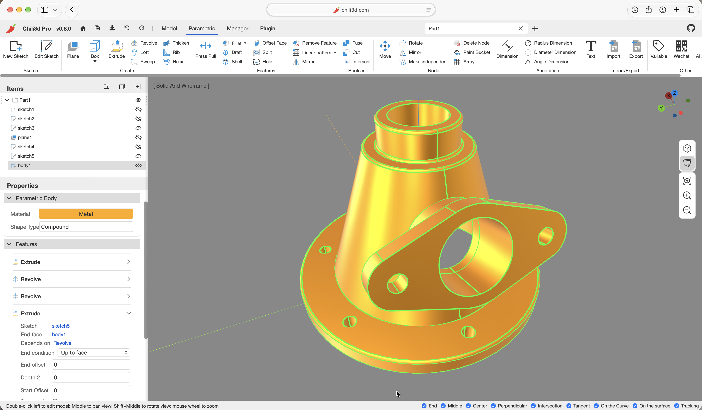
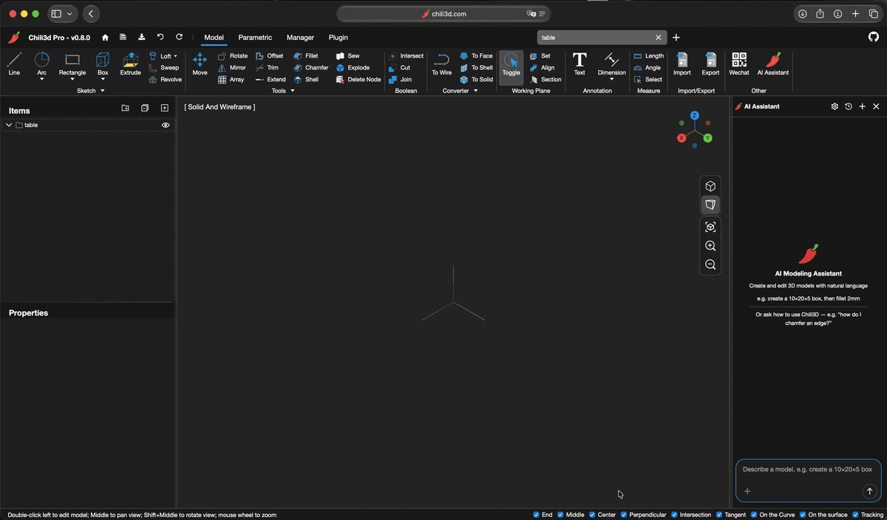
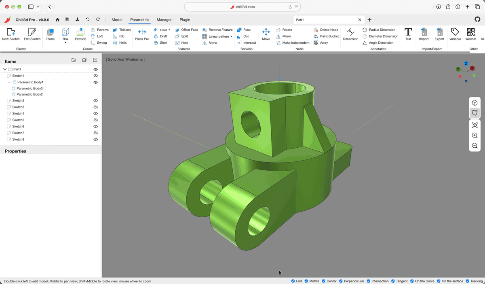
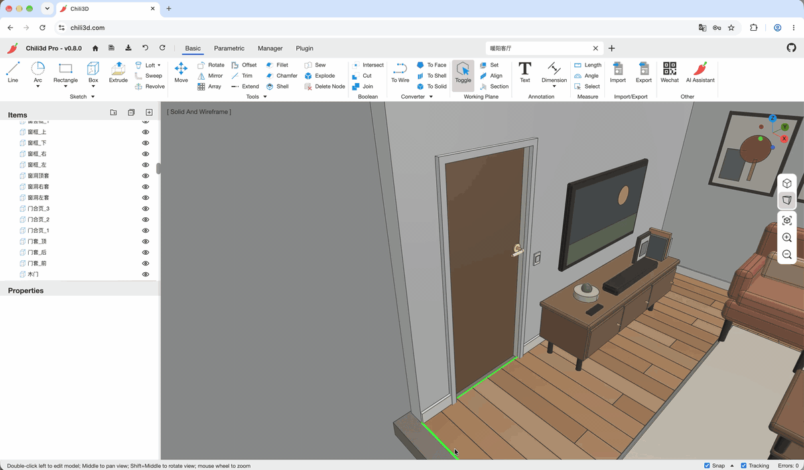

# Chili3D

An open-source, browser-based 3D CAD for AI-assisted, parametric and direct modeling.

<p align="center">
  
</p>

<p align="center">
  <strong>Try it now:</strong> <a href="https://chili3d.com"><strong>chili3d.com</strong></a> — official site; a <a href="https://chili3d.pages.dev">Cloudflare mirror</a> is available as a backup.
</p>

## Overview

[Chili3D](https://chili3d.com) is an [open-source](https://github.com/xiangechen/chili3d) 3D CAD (Computer-Aided Design) application built with TypeScript. It compiles OpenCascade (OCCT) to WebAssembly and renders through Three.js, bringing near-native modeling performance to the browser. AI, parametric and direct modeling share one document, viewport and undo stack, so you can move between them mid-design — a shape built by hand can be edited by the assistant, and an AI-built body is still a feature tree you can change.

## Features

### AI-Native Modeling

The built-in assistant runs entirely in the browser and calls the LLM endpoint directly with your own API key — there is no relay server in between. AI-native here means it is not a side panel bolted on: it reads and writes the same document, selection and feature tree as the commands, and every change it makes lands in the same undo stack.

<p align="center">
  
</p>

<p align="center"><em>One sentence builds the table. When a sweep call fails, the assistant diagnoses the error and corrects it on its own, then retextures the top.</em></p>

- **What It Can Do**: build a part from a description, reshape an existing model (dimensions, fillets, holes, booleans), measure lengths, areas and volumes, query face/curve/surface types, organize the tree, set properties and materials, manage document variables, adjust the view and export the result — all through chat
- **Document Awareness**: reads the document tree, the geometry and the current selection, and captures viewport screenshots, so a request like "make this flange thicker" resolves against the right nodes
- **Two Modeling Paths**: `run_program` applies modeling operations to produce geometry (one call is one undo step); `run_parametric` builds a parametric feature tree the user can keep editing afterwards
- **Reference Images**: paste or upload a picture to model from; the image is read before any geometry-changing tool is allowed to run
- **Providers**: Anthropic API, OpenAI Completions API and OpenAI Responses API, with a configurable base URL, model, reasoning effort and context window; the API key is kept only for the session and can be handed to the browser's password manager
- **On-Demand Skills**: guidance for the app, the modeling API, shape/curve/surface queries, modeling recipes, error recovery and parametric modeling are loaded only when the model asks for them, keeping the prompt small
- **Conversations**: saved locally, with automatic context budgeting that compacts old turns into a condensed journal instead of losing the thread
- **Local Bridge**: `?bridge=<port>` connects the page to a local process over a WebSocket (outbound, default port 17373), and that process — the separate `chili3d-mcp` server — calls the same tool registry the chat panel uses, so an external agent can read and edit the open document; without the parameter, none of it is loaded

### Parametric Modeling

Parametric bodies are feature-list models in the Onshape/Fusion style: a body stores no baked shape, only an ordered list of features, and the list is replayed top to bottom on every rebuild. Editing any upstream feature — a dimension, a sketch line, a suppressed step — re-evaluates everything downstream of it.

<p align="center">
  
</p>

<p align="center"><em>Edit one dimension in a fully constrained sketch, and every downstream feature rebuilds from it.</em></p>

- **Feature List**: ordered, editable, reorder-aware features with per-feature suppression, rename and warnings; one body evaluates as a chain, so a change never leaves stale geometry behind
- **Features**: primitive, extrude (blind, symmetric, up-to-face/vertex), revolve, loft, sweep, helix, hole (with standard sizes), rib, draft, shell, thicken, fillet, chamfer, boolean, mirror, pattern, split, sew, offset face and transform
- **2D Sketches**: lines, arcs, circles, ellipses, conics, splines and text, with geometric and dimensional constraints, construction geometry, auto-constraints, projected edges and external references; profiles stay solved by the embedded garlic constraint solver
- **Stable References**: downstream features refer to faces, edges, vertices and sketch profiles by tracked identity, so those references still resolve after an upstream change; a reference that cannot be resolved can be re-selected without rebuilding the feature
- **Variables**: document variables drive feature dimensions and can suppress a feature when they resolve to zero
- **Interactive Preview**: press-pull on faces, drag handles for extrusion depth, draft angles and fillet/chamfer radii, with the result previewed before it is committed

### Direct Modeling

Direct modeling works on the geometry itself: a command creates a shape node or replaces the shape of an existing one, with no feature history behind it. It is the fastest path for one-off shapes and for editing imported geometry.

<p align="center">
  
</p>

<p align="center"><em>An imported interior model edited face by face: pick a face, drag the Push/Pull handle, and the geometry changes in place — no feature history required.</em></p>

- **Basic Shapes**: boxes, spheres, cylinders, cones, pyramids, and more
- **Curves and Wireframes**: lines, arcs, circles, ellipses, Bézier curves, polygons, helices, pipes and text
- **Advanced Operations**:
    - Boolean operations (union, difference, intersection)
    - Extrusion, revolution, sweeping, lofting and Gordon surfaces
    - Thick solid, shell and surface offset
    - Shape conversion, sectioning and curve projection
    - Shape checking and repair
- **Editing**: chamfer, fillet, trim, break, extend, split, sew, simplify, feature removal, sub-shape copy/removal, explode
- **Interactive Input**: pick faces, edges and snap points in the viewport, with a live preview and an option panel while the command is running
- **Transformation**: move, rotate, mirror, linear and circular arrays, copy

The commercial **Chili3D Pro** edition extends this into a full direct-editing session: double-click a shape to edit its B-rep in place — push/pull faces, round or chamfer edges with a drag handle, split with drawn curves, and hide or lock the rest of the scene while you work.

### Other Features

- **Snapping and Tracking**: snap to points, edges, faces and the workplane; track axes and detected feature points, with visual guides for both
- **Measurement**: measure lengths and angles, and total up length, area and volume across a selection
- **Documents**: create, open and save documents with a full transaction-based undo/redo stack; import and export STEP, IGES, BREP and STL
- **Interface**: Office-style contextual ribbon, hierarchical assembly tree, dynamic workplanes, turntable/trackball camera with position recall, and a command panel docked in the viewport
- **Plugins**: load plugins at runtime with `?plugin=<url>`; the `plugins/` directory has a macro editor and a Rete.js visual-programming editor
- **Localization**: built-in i18n for English, Chinese (zh-cn) and Portuguese (Brazil); further locales welcome

## Architecture

Chili3D is an npm workspace monorepo under `packages/`. `core` defines the interfaces; every other package implements or wires them:

```
web ──> builder ──> app ──> core + wasm
                  ──> parametric ──> core
                  ──> i18n ──> core
                  ──> three ──> core
                  ──> storage ──> core
                  ──> ui ──> core + element
                        └─> ai ──> core + element (+ parametric, loaded on demand)

element ──> core
```

- **`core`** — Abstract interfaces (`IShape`, `IShapeFactory`), math (`XYZ`, `Matrix4`, `Plane`), document model, reactive data (`Observable`, `Binding`, `PubSub`), `Result<T,E>`, transactions/undo/redo, commands, serialization, plugin system, service container, UI abstractions
- **`element`** — Custom reactive DOM elements (radio groups, expanders, data converters)
- **`wasm`** — Concrete `ShapeFactory` calling into OCCT via Emscripten bindings
- **`parametric`** — Feature-list bodies and the 2D sketch module: ordered feature data + handlers replayed on rebuild, the garlic constraint solver wrapper, tracked sub-shape references (`EdgeRef`, `ProfileRef`, vertex refs), body timelines, reselect sessions and the parametric command set
- **`three`** — Three.js viewport, camera controller, visual objects, highlighter, outline pass, gizmo, mesh export
- **`i18n`** — Locale data (en, zh-cn, pt-br)
- **`storage`** — IndexedDB persistence layer
- **`ai`** — In-app assistant: browser-direct LLM providers, tool registry, the `run_program` capability engine and on-demand skills; the parametric module is pulled in lazily on first `run_parametric`. Also the `?bridge=<port>` client (`src/bridge/`) that hands the same tool registry to a local process over a WebSocket
- **`ui`** — Application chrome: main window, ribbon/toolbar, property panels, project tree, dialogs, toast, status bar, chat panel host
- **`app`** — Concrete `Application`, direct-modeling body node classes, command implementations, `CommandService`, `HotkeyService`
- **`builder`** — `AppBuilder` with a fluent `.useIndexedDB().useWasmOcc().useParametric().useThree().useUI().build()` chain and default ribbon layout
- **`web`** — Entry point: calls `AppBuilder`, shows loading screen, parses URL parameters

## Technology Stack

- **Frontend**: TypeScript, Three.js (0.184)
- **3D Kernel**: OpenCascade 8.0.1 (OCCT) compiled to WebAssembly via Emscripten
- **Parametric Solver**: garlic, vendored and compiled to WebAssembly for 2D sketch constraints
- **AI Assistant**: Anthropic / OpenAI SDKs, called directly from the browser
- **Bundler**: Rspack 2
- **Linting & Formatting**: Biome (TypeScript), clang-format (C++)
- **Testing**: Rstest + Happy-DOM
- **Package Manager**: npm workspaces

## Getting Started

### Prerequisites

- Node.js and npm — CI builds with Node 24, so that is the safest version to use
- To run the app: a modern browser with WebAssembly and WebGL 2 support

### Installation

1. Clone the repository

    ```bash
    git clone https://github.com/xiangechen/chili3d.git
    cd chili3d
    ```

2. Install dependencies

    ```bash
    npm install
    ```

### Development

Start the development server:

```bash
npm run dev   # Launches at http://localhost:8080
```

### Building

Build the application:

```bash
npm run build
```

### WASM Build (Optional)

The prebuilt WASM module is included in the repository. If you want to build it from source:

1. Set up WebAssembly dependencies (one-time setup):

    ```bash
    npm run setup:wasm
    ```

2. Build the WebAssembly module:

    ```bash
    npm run build:wasm
    ```

### Testing & Linting

```bash
npm run test             # Run all tests (Rstest + Happy-DOM)
npm run testc            # Tests with coverage
npm run test:scenarios   # Drive the real app in headless Chrome (needs `npm run dev` running)
npm run check            # Biome lint + auto-fix
npm run format           # Biome + clang-format across all files
```

### Docker

You can also deploy with Docker:

```bash
docker compose up -d   # Builds and serves the app at http://localhost:8080
```

## Code Style

- **TypeScript**: Biome for linting and formatting — 4-space indent, 110-char line width, double quotes, semicolons always
- **C++**: clang-format with WebKit style
- Interfaces prefixed with `I` (`IShape`, `ICommand`)
- `camelCase` functions/variables, `PascalCase` classes, `UPPER_SNAKE_CASE` constants
- Type-only imports: `import type { IFoo } from "..."`
- Pre-commit hooks via simple-git-hooks + lint-staged

## Changelog

See the [GitHub releases](https://github.com/xiangechen/chili3d/releases) for the full changelog and release notes.

Chinese-speaking users can also follow the [video walkthroughs on Bilibili](https://space.bilibili.com/539380032/lists/3108412?type=season).

## Contributing

We welcome contributions! Please feel free to submit pull requests or open issues.

Before submitting a PR, run `npm run check` to ensure your code passes linting.

## Contact

- **Discussions**: Join our [GitHub discussions](https://github.com/xiangechen/chili3d/discussions) for general chat or questions
- **Issues**: Use [GitHub issues](https://github.com/xiangechen/chili3d/issues) to report suggestions or bugs
- **Email**: Contact us privately at xiangetg@msn.cn

## License

Distributed under the GNU Affero General Public License v3.0 (AGPL-3.0). For commercial licensing options, contact xiangetg@msn.cn.

Full license details: [LICENSE](LICENSE)

The C++ WASM module (`cpp/`) is licensed under LGPL-3.0.

## Analytics Notice

Chili3D uses [Microsoft Clarity](https://clarity.microsoft.com) for growth analytics. To disable data collection, remove the Clarity script from `public/index.html`.

## Disclaimer

This software is provided "AS IS," and the authors and contributors hereby disclaim all express and implied warranties. The user shall bear full responsibility for any and all risks and potential consequences arising from the use of this software. Such risks and consequences include, but are not limited to:

1. Data loss, system failures, or any direct or indirect damages;
2. Conduct violating applicable laws or regulations resulting from software usage and its consequences;
3. All liabilities arising from the software's use for illegal purposes or activities.
