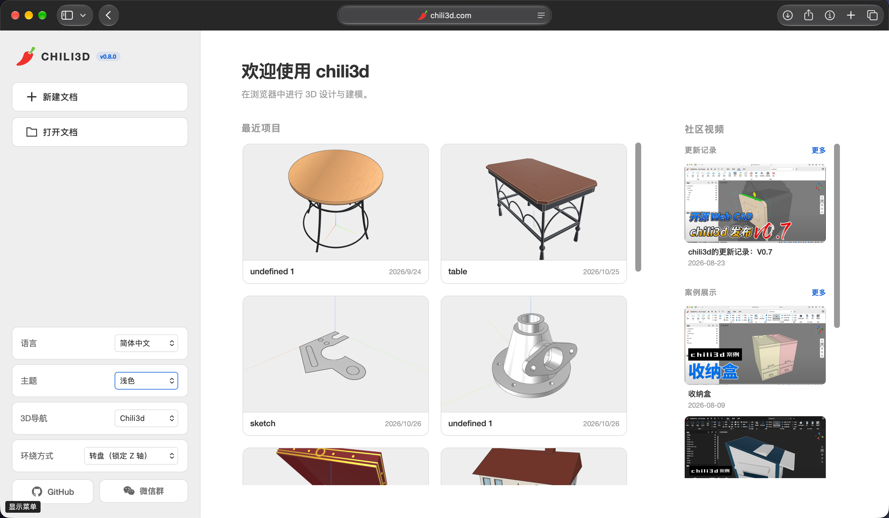
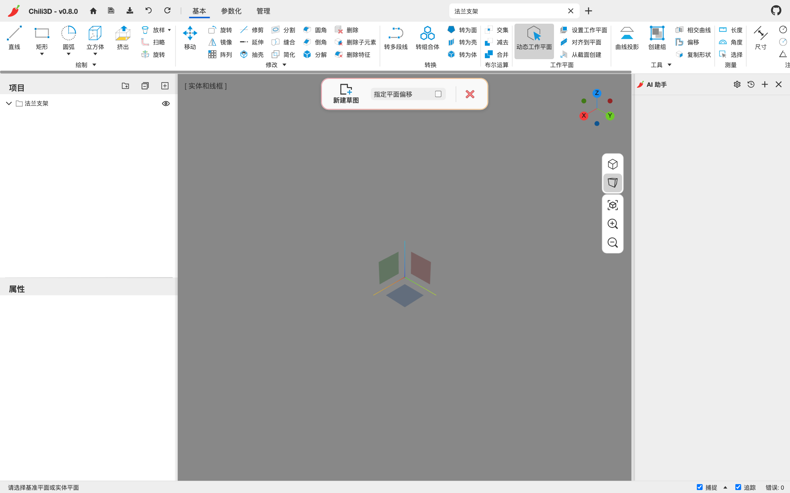
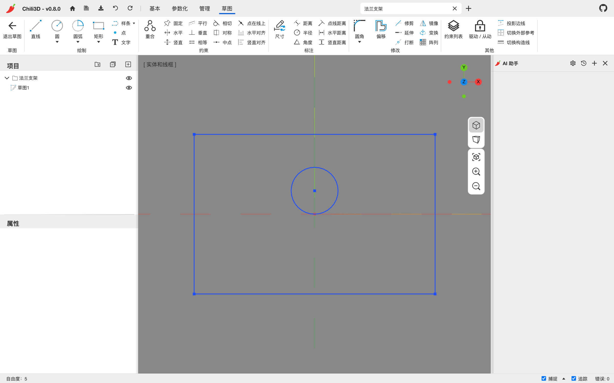
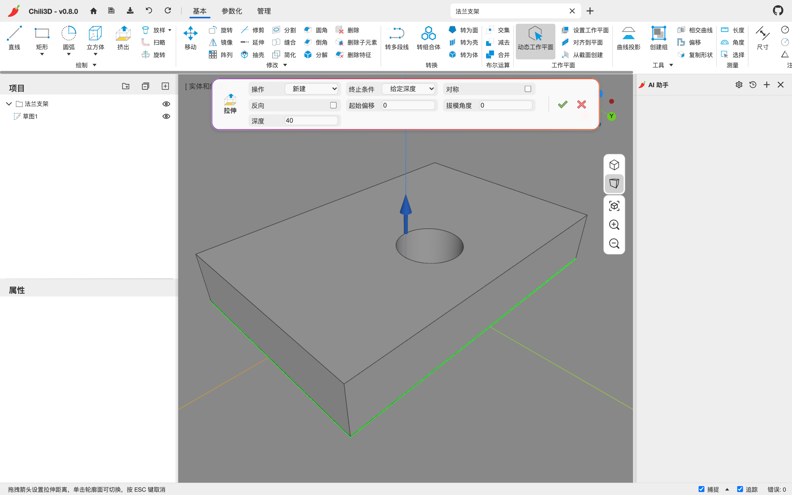
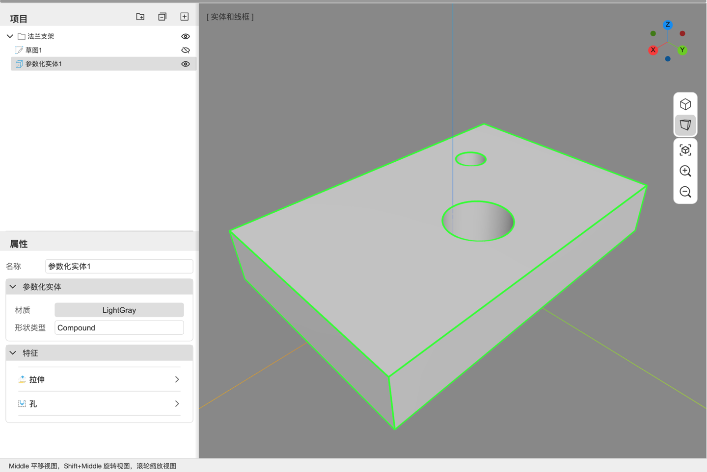

# 1. 快速开始

这一章带你从零做出一个带孔的板件，并保存成浏览器内的文档。全程只需要鼠标和键盘，不需要安装任何东西。

## 1.1 打开应用

在浏览器中访问 [chili3d.com](https://chili3d.com)（或备用镜像 [chili3d.pages.dev](https://chili3d.pages.dev)）。本地开发时运行 `npm run dev` 后访问 `http://localhost:8080`。

浏览器需要支持 **WebAssembly** 和 **WebGL 2**。首次打开时，加载画面会下载并初始化 OCCT 内核，通常几秒到十几秒；内核初始化完成后才会出现首页。

## 1.2 首页

首页分三块：

- **左侧**：`新建文档`、`打开文档`；下方是语言、主题、3D 导航、环绕方式四个设置项。
- **中间**：`最近项目`。保存过的文档会在这里出现，点击卡片即可打开。卡片上的 `×` 不是“只移除入口”：确认后会同时删除浏览器中的文档本体和最近记录，删除前请先导出 `.cd` 备份。
- **右侧**：社区视频（更新记录与案例展示），点击缩略图会在新标签页打开视频。

设置项在浏览器本地保存，下次打开仍然生效。各项含义见 [第 10 章](10-settings-plugins.md)。文档和设置按浏览器源隔离，官网、镜像和不同本地端口之间不会自动同步。

> 如果只想快速试一下：点 `新建文档`，直接跳到 1.4。

## 1.3 新建文档

点 `新建文档`。应用会创建一个新文档、打开它的视图，并在右侧显示 AI 助手面板。

第一次使用 AI 助手时会自动弹出“AI 助手设置”。暂时不用 AI 的话，点右下角 `取消` 即可关闭；需要时再点面板右上角的齿轮图标打开。设置方法见 [第 9 章](09-ai-assistant.md)。

新文档默认叫 `undefined 1`。保存前请改成有意义的名字：

1. 在左侧项目树中点击根节点（文档名）。
2. 在下方的“属性”面板里，把“名称”改为例如 `法兰支架`，按回车。

文档标签和项目树会同步更新。

## 1.4 做第一个零件

我们要做一块约 240 × 160 × 40 的板：草图里画一个内孔轮廓（拉伸时直接成为通孔），之后再添加一个标准孔特征。

### 第一步：画草图

1. 切到 **参数化** 功能区，点 `新建草图`。
   也可以在 **基本** 功能区的 `绘制` 组里点 `矩形` 直接画，但那样得到的是直接建模图形；这里走参数化路线。

   

2. 视口中央会出现三个半透明的基准面方块：红色是 YZ 面、绿色是 ZX 面、蓝色是 XY 面。点蓝色方块（XY 面）的任意位置。
   默认的“动态工作平面”会让你点在哪个面上就落在哪个面，所以点方块本身即可。

3. 草图编辑器随即打开：视口转到正对草图平面，功能区切换到 **草图** 标签（这是上下文标签，只在草图会话中出现）。

   

4. 点 `矩形`，在视口里点一下作为第一个角，再点一下作为对角。拖动时状态栏会实时显示 `宽, 高`。
   也可以在第一点之后直接键入 `240,160` 再回车，得到精确尺寸；截图中的拾取结果只是接近这个尺寸。

5. 点 `圆`，在矩形中心附近点一下作为圆心，再点一下确定半径（或直接键入半径值）。

6. 按 `Esc` 退出当前绘图工具。如果工具链还在继续，第一次 `Esc` 结束当前链，第二次才退出工具。

   这个快速示例先用拾取位置确定几何，因此草图不一定完全约束。正式设计建议再用 `尺寸`、`重合` 等约束明确宽度、高度、圆心和半径；需要随变量更新的孔位，可使用独立点和尺寸表达式。完整做法见 [第 12.1 节](12-workflows.md#121-参数化安装板从变量到交付)。

7. 点功能区的 `退出草图`，或再次按 `Esc` 直到回到文档。

### 第二步：拉伸

1. 在项目树里点击刚创建的 `草图1`（如果草图已被选中则跳过）。
2. 切到 **参数化** 功能区，点 `拉伸`。
3. 视口里出现拉伸预览和一个蓝色箭头。命令面板同时出现：

   

   - `操作`：新建 / 加入 / 移除 / 相交
   - `终止条件`：给定深度 / 完全贯穿 / 到面 / 到点
   - `对称`、`反向`、`起始偏移`、`拔模角度`、`深度`
4. 在 `深度` 输入框里键入 `40` 后按回车。也可以拖动蓝色箭头设置深度。
5. 再按一次回车，或点命令面板右侧的绿色对勾，提交特征。

   结果是一个参数化实体，项目树里出现 `参数化实体1`，属性面板下方出现“特征”列表。

### 第三步：加一个孔

1. 选中 `参数化实体1`，点 **参数化** 功能区的 `孔`。
2. 命令面板里把 `直径` 改为 `24`，`深度` 留空表示贯通。
3. 在板的上表面点一下，确定钻孔面。
4. 在面上点一下孔中心（可点多处），按回车结束。

### 第四步：查看成果

1. 选中 `参数化实体1`，属性面板会显示它的特征列表：

   

2. 点任一特征行（行尾的 `›` 会变成 `⌄`）即可展开，在行内修改参数；按回车或点走即提交。修改后整条特征链会从头重建。行尾的 `⋯` 是重命名、重新选择、抑制、删除的菜单。
3. 用视口右上角的 `适应内容` 按钮（方框图标）把模型框满视口。

## 1.5 保存

两种保存方式，区别很重要：

| 方式 | 位置 | 用途 |
| --- | --- | --- |
| `保存`（Ctrl+S；macOS 也可用 Cmd+S） | 浏览器 IndexedDB | 日常保存；文档出现在首页“最近项目” |
| `保存到文件` | 下载一个 `.cd` 文件 | 备份、换浏览器/换电脑、发给别人 |

- 标题栏左上的图标依次是 `首页`、`保存`、`保存到文件`、`撤销`、`重做`；`打开文档` 用 Ctrl+O、首页的“打开文档”，或直接把 `.cd` 拖进窗口。
- **应用不会自动保存。** 关闭标签页或文档前请先手动保存；重要工作同时保留 `.cd` 和 STEP 备份。
- 点文档标签的 `×` 时，确认框的 `确定` 表示保存到 IndexedDB 后关闭，`取消` 表示**不保存并继续关闭**，不是返回文档。这个原生确认框没有“取消关闭”的第三选项；如果目的是保留修改，应选择 `确定`，并在关闭前养成手动保存的习惯。
- `.cd` 文件可以用 `打开文档` 重新载入，也可以直接拖进窗口。它会保留原文档 ID，不等同于创建一个全新 ID 的“另存为”副本。
- 首页最近项目卡片的 `×` 会删除文档本体，不只是移除卡片。不要把它当作清理列表的快捷方式。

版本、文档 ID 和跨浏览器备份详见 [第 8 章](08-document-files.md)。

## 1.6 三种建模方式怎么选

| 方式 | 入口 | 特点 | 适合 |
| --- | --- | --- | --- |
| 直接建模 | **基本** 功能区 | 每个命令直接生成/替换一个形状节点，没有历史 | 一次性形状、导入模型的修补 |
| 参数化建模 | **参数化** 功能区 + 草图 | 实体只存特征列表，改上游会自动重建下游 | 需要反复改尺寸、要保留设计意图 |
| AI 建模 | 右侧 AI 助手 | 自然语言描述，应用内调用你自己的模型 API | 快速起草、批量修改、查询/测量 |

三者可以混用：同一个文档里既能放直接建模的盒子，也能放参数化实体；AI 的操作同样落在同一个撤销栈里。混用前仍需确认命令会不会消耗源节点，以及 AI 是否在原来的参数化体上继续操作。

**Pro 的直接编辑**是另一种修改现有几何的方式：双击模型进入编辑模式，直接拖拽或修改边、面，入口和命令见 [第 13 章](13-pro-direct-editing.md)。它不是参数化历史编辑器；参数化节点转为可编辑节点后会丢失特征列表，实例则会转到源节点修改。

想继续做完整练习，可跳到 [第 12 章 典型工作流程](12-workflows.md)。

---

下一步：[第 2 章 界面总览](02-interface.md)
