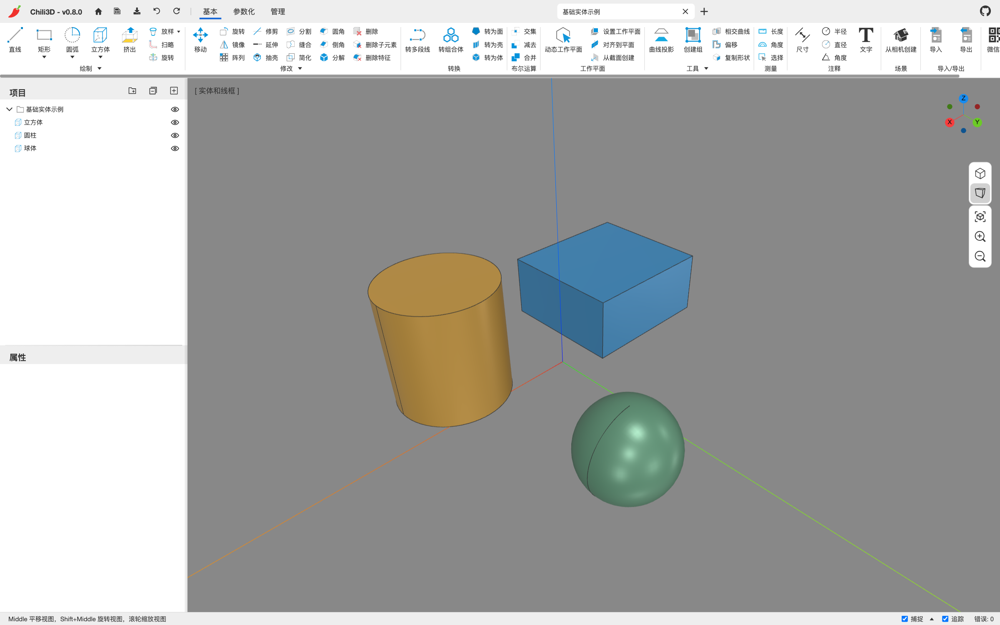
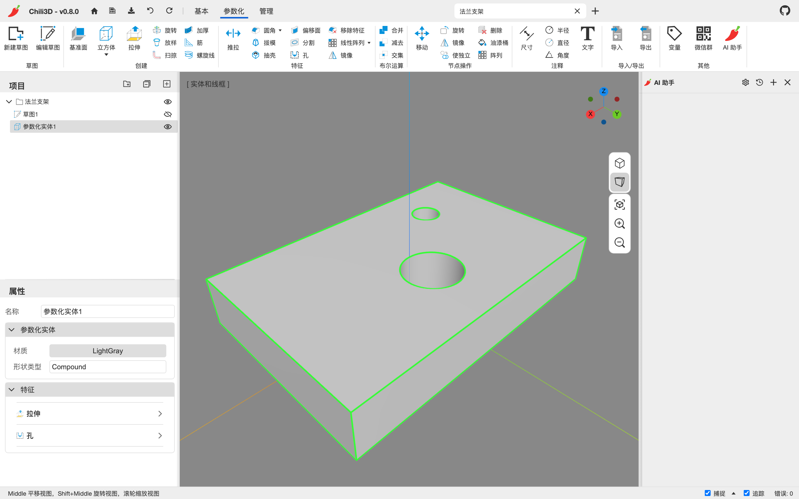
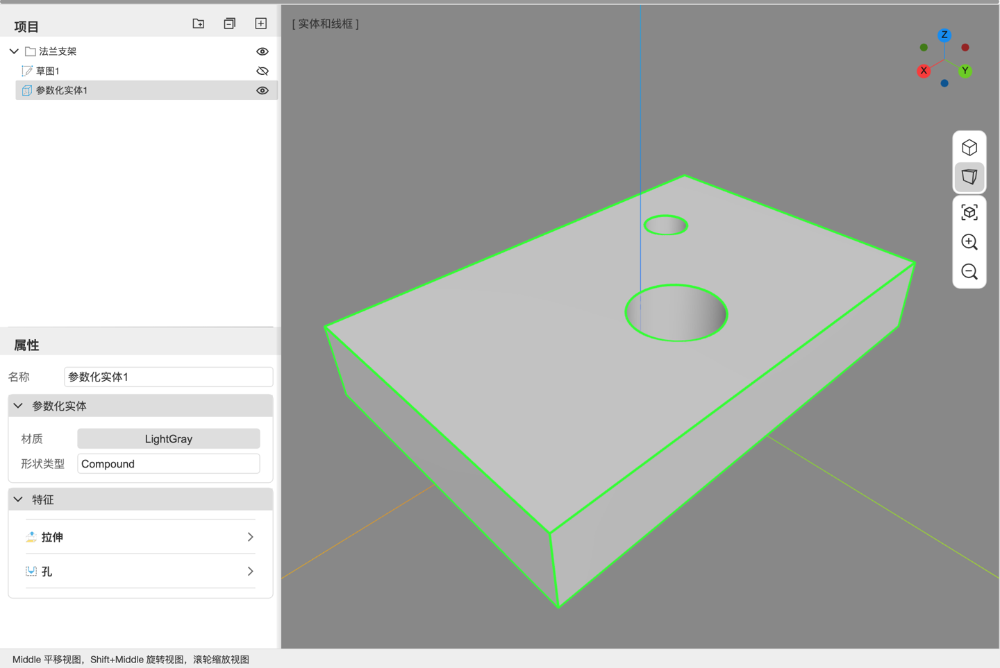
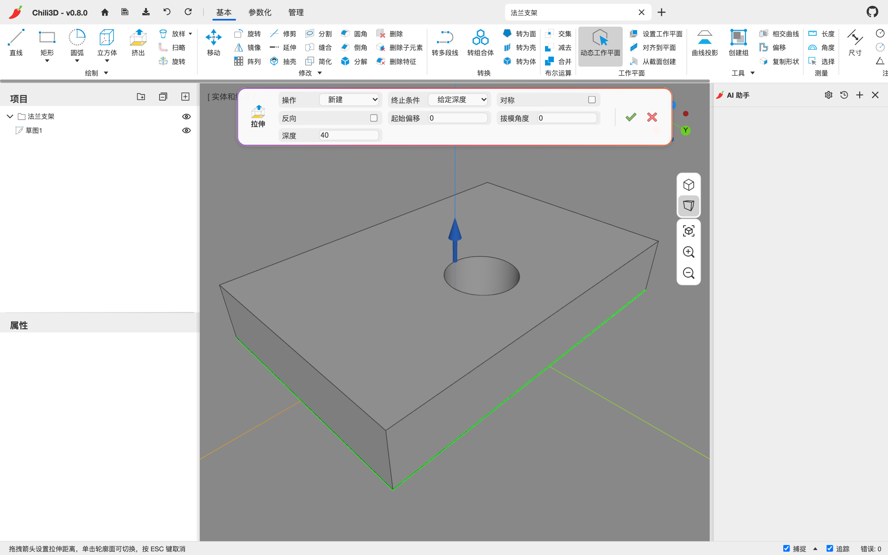
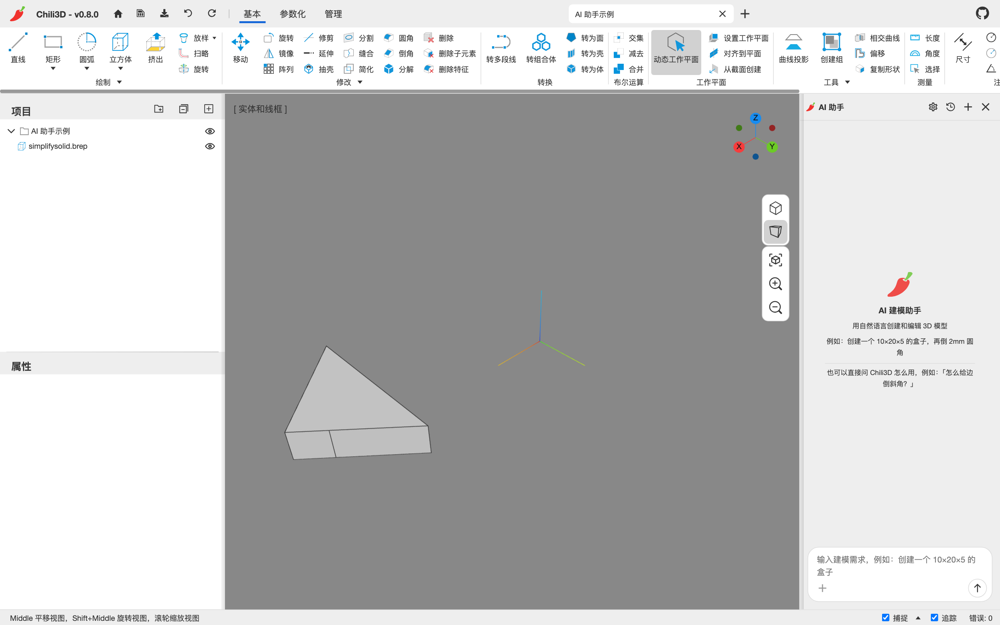

# 2. 界面总览

Chili3D 的主界面由标题栏、功能区、视口、项目树、属性面板、状态栏和 AI 助手面板组成。不熟悉节点、参数化体、实例等名词时，可先查 [附录 C 术语表](appendix-glossary.md)。

## 2.1 标题栏

从左到右：

| 区域 | 内容 |
| --- | --- |
| 品牌 | 辣椒图标与 `Chili3D - v0.8.0`，点击回到首页 |
| 首页 | 房子图标，回到启动页 |
| 快捷命令 | `保存`（Ctrl+S）、`保存到文件`、`撤销`（Ctrl+Z）、`重做`（Ctrl+Y / Ctrl+Shift+Z） |
| 功能区标签 | `基本`、`参数化`、`管理`；进入草图时右侧临时出现 `草图` |
| 文档标签 | 每个打开的文档一个标签，点标签切换；`×` 关闭，右侧 `+` 新建文档 |
| 右侧 | GitHub 仓库链接 |

文档标签同时显示文档名。文档名可在项目树根节点 + 属性面板修改，保存后会显示在首页“最近项目”中。

## 2.2 功能区（Ribbon）

功能区是 Office 风格的多标签工具栏。三个常驻标签：

### 基本

直接建模命令，按组排列：

| 组 | 内容 |
| --- | --- |
| 绘制 | 直线、矩形、圆弧（4 种）、立方体/球体/圆柱/圆锥/棱锥（组内下拉）、挤出、放样/戈登（下拉）、扫略、旋转 |
| 修改 | 移动、旋转/镜像/阵列、修剪/延伸/抽壳、分割/缝合/简化、圆角/倒角/分解、删除/删除子元素/删除特征 |
| 转换 | 转多段线、转组合体、转为面/壳/体 |
| 布尔运算 | 交集、减去、合并 |
| 工作平面 | 动态工作平面开关、设置工作平面/对齐到平面/从截面创建 |
| 工具 | 曲线投影、创建组、相交曲线/偏移/复制形状，下拉里还有修复形状/检查形状 |
| 测量 | 长度、角度、选择（汇总面积/体积） |
| 注释 | 尺寸、半径/直径/角度、文字 |
| 场景 | 从相机创建（视角书签） |
| 导入/导出 | 导入、导出 |
| 其他 | 微信群二维码、AI 助手开关 |

### 参数化

| 组 | 内容 |
| --- | --- |
| 草图 | 新建草图、编辑草图 |
| 创建 | 基准面、立方体/圆柱/球体/圆锥（下拉）、拉伸、旋转/放样/扫掠、加厚/筋/螺旋线 |
| 特征 | 推拉、圆角/倒角/修改圆角/修改倒角（下拉）、拔模、抽壳、偏移面/分割/孔、移除特征/线性/环形/曲线阵列（下拉）、镜像 |
| 布尔运算 | 合并、减去、交集 |
| 节点操作 | 移动、旋转/镜像/使独立、删除/油漆桶/阵列 |
| 注释 | 与基本标签相同 |
| 导入/导出 | 与基本标签相同 |
| 其他 | 变量、微信群、AI 助手 |

### 管理

目前只有 `性能测试` 一个命令（在新建文档中创建 20×20×20 个随机盒子并报告耗时），用于粗略检查内核与渲染性能。

### 草图（上下文标签）

只有进入草图会话时才会出现，包含退出草图、绘图、约束、标注、修改、其他五组：见 [第 7 章](07-sketch.md)。

### 组的折叠下拉

组名右侧带小三角的按钮是下拉组（split button）：点击组名本身执行“主”命令，点小三角展开其余命令。例如“修改 → 旋转”主按钮是旋转，下拉里还有镜像、阵列。

## 2.3 视口

视口是中央的 3D 区域，左上角显示当前显示模式，例如 `[ 实体和线框 ]`。

### 显示模式

点左上角的 `[ 实体和线框 ]` 展开菜单：

- **实体**：只显示着色实体。
- **线框**：只显示边线。
- **实体和线框**：着色 + 边线，默认。

### 相机控件（视口右侧竖排）

| 图标 | 功能 |
| --- | --- |
| 正交视图图标 | 切到正交投影 |
| 透视视图图标 | 切到透视投影（默认） |
| 四角框 | 适应内容（优先当前选择；无选择时框场景） |
| 放大镜 + | 以视口中心放大 |
| 放大镜 − | 以视口中心缩小 |

### 坐标轴指示器

视口右上角的 X/Y/Z 彩色小球是坐标轴指示器，不是视图立方体：

- 点任意小球：相机转到沿该轴正视。
- 按住拖动：自由环绕。

### 视角书签（场景）

点 **基本 → 场景 → 从相机创建**，会把当前相机位置、目标点和上方向保存为一个“场景”书签，出现在视口底部中央。之后：

- 点书签：相机飞回该视角。
- 点书签右侧齿轮：重命名。
- 点 `×`：删除书签。

## 2.4 项目树

左上侧是项目树，显示当前文档的节点层级。

- **选择**：单击选中；`Ctrl+单击` 切换多选（macOS 也用 `Ctrl`，不是 `Cmd`）；`Shift+单击` 连续范围选择。
- **可见性**：行尾的眼睛图标切换显示/隐藏。父节点隐藏时，子节点的眼睛会变灰。
- **重命名**：树里没有重命名。选中节点后在属性面板改“名称”。
- **层级**：树支持文件夹（工具栏第一个图标）和拖放。把行拖到**文件夹**上会成为它的子节点；拖到普通行上会插入到该行之前（同一父级）。参数化体下面的隐藏输入（被消耗的工具）不能单独拖走。
- **警告标记**：节点右侧出现 `!` 时，悬停可看原因（例如草图的外部参考丢失）。
- **工具栏**：新建文件夹、全部折叠、全部展开。
- **草图**：双击草图节点可以进入草图编辑会话。

## 2.5 属性面板

左下侧显示当前选中对象的属性。先在项目树确认选中的是目标节点；常见的几块：

1. **名称**：文本输入，回车提交。
2. **矩阵**（可展开）：位移、旋转、缩放，只出现在支持直接变换的节点上。参数化体的移动会记录为特征，草图也不提供直接矩阵编辑。
3. **形状参数**：只显示该节点实际提供的可编辑字段，例如立方体的长/宽/高、矩形的宽/高、圆的半径、圆柱的半径与高度、挤出的长度。改动会立刻重建该节点，算作一次撤销步骤。
4. **材质**：显示当前材质名；点击色块打开材质编辑器（见 [第 5.6 节](05-modify-convert-measure.md#56-材质与外观)）。
5. **特征**（仅参数化体）：有序特征列表，每行可展开参数、重排、抑制、重命名、重新选择和删除。详见 [第 6 章](06-parametric-modeling.md)。

属性面板的编辑即时生效，并且与 AI 的 `set_node_properties` 修改的是同一批底层属性。但它不是原命令面板的完整副本：**只有实际列出的字段才可编辑**。没有出现的轮廓、旋转轴、扫掠路径等输入不能在这里补改；这类直接建模结果通常只能撤销后重做，或用参数化体重建，详见 [第 4.6 节](04-direct-modeling.md#46-直接建模的编辑方式)。

修改后先检查视口和项目树中的结果。若形状异常或改错了对象，立即 `Ctrl+Z` 撤销这次编辑；不要继续在错误结果上叠加命令。

## 2.6 状态栏

底部状态栏分两半：

- **左**：当前提示。默认显示导航方式（`Middle 平移视图，Shift+Middle 旋转视图，滚轮缩放视图`）；执行命令时显示下一步要做什么，例如“请选择面”“请选择边”“回车结束”。**遇到不确定时，先看这一行。**
- **右**：`捕捉` 复选框控制总开关，旁边的小箭头展开 8 个捕捉类型；`追踪` 单独开关，含义见 [第 3.5 节](03-view-navigation-selection.md#35-捕捉与追踪)。`错误: n` 打开“错误记录”，可查看最近的错误详情或清空记录。

## 2.7 命令面板

执行需要参数的命令时，视口上方会出现一个浮动面板，显示命令图标、名称、可调选项以及确认/取消按钮。

- 选项包括下拉框（操作、终止条件）、文本框（深度、偏移、角度）、复选框（对称、反向、合并）。
- 文本输入**在失焦或按回车时提交**，随后视口预览会更新。
- 需要拾取时，面板右侧显示已选数量、绿色对勾（确认）和红色叉（取消）。
- `Esc` 取消整个命令；`Enter` / `Space` 确认当前拾取或提交拖拽值。

## 2.8 AI 助手面板

右侧停靠的 AI 助手面板：可以关闭、拖出成浮动窗口、再拖回停靠。详情见 [第 9 章](09-ai-assistant.md)。

## 2.9 Pro 上下文“编辑”标签

仅 **Chili3D Pro** 提供。双击视口中的模型并进入直接编辑后，功能区自动显示 **编辑** 标签；退出后自动关闭。

| 组 | 内容 |
| --- | --- |
| 分割 | 线、圆弧（4 种）、圆/椭圆、矩形/多边形、偏移；除偏移外的绘制工具可切换为辅助线 |
| 修改 | 移动、复制、旋转、镜像、阵列；处理当前节点的子形状或分割线 |
| 工具 | 推拉、偏移面、简化、修复、圆角/倒角、特征删除 |
| 管理 | 编辑设置（隔离模式、拖拽编辑圆角）、退出 |

编辑时只处理当前可编辑节点，其他对象按设置被锁定或隐藏。参数化节点在双击后需要先转换，转换会丢失原特征列表；完整操作和注意事项见 [第 13 章 Pro 直接编辑](13-pro-direct-editing.md)。

---

下一步：[第 3 章 视图、选择与捕捉](03-view-navigation-selection.md)
