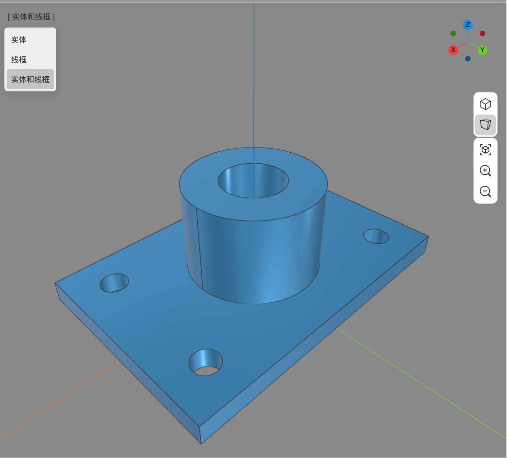
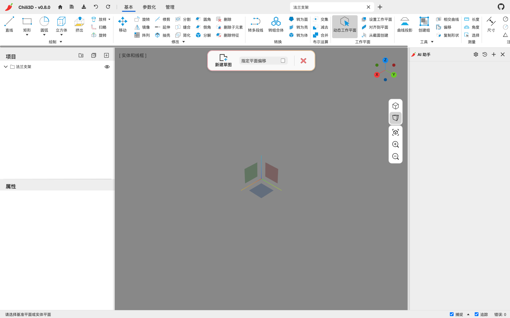

# 3. 视图、选择与捕捉

## 3.1 相机导航

Chili3D 提供 5 套导航配置，在首页的“3D 导航”里选择；状态栏会显示当前配置的鼠标提示。默认是 **Chili3d**。

| 配置 | 平移 | 旋转 |
| --- | --- | --- |
| Chili3d | 中键拖动 | Shift + 中键拖动 |
| Revit | 中键拖动 | Shift + 中键拖动 |
| Blender | Shift + 中键拖动 | 中键拖动 |
| Creo | Shift + 中键拖动 | 中键拖动 |
| Solidworks | Ctrl + 中键拖动 | 中键拖动 |

其他通用操作：

- **滚轮**：朝光标方向缩放。Solidworks 与 Creo 配置会反转滚轮方向以匹配原软件。
- **双击中键**（半秒内两次）：适应内容。
- **左键拖动**：不是旋转相机，而是拉出矩形框选。旋转围绕当前选择的中心，或光标下形状的中心。
- **右键**：不弹浏览器菜单；在草图里，右键可以取消当前拾取。
- **触屏**：单指拖动（拾取激活时）、双指平移缩放、三指旋转。

## 3.2 投影与显示

- 视口右侧的两个图标分别切换到**正交**和**透视**投影。
- 左上角的 `[ 实体和线框 ]` 点开可切换 **实体 / 线框 / 实体和线框**。
- **适应内容**：有当前选择时优先把选择框满视口；无选择时框场景。新建文档后模型很小、看不见时，可以先点它。
- 要框全场景，先在没有运行命令时按 `Esc` 清除选择，再点“适应内容”。可见性不是范围计算的唯一条件：隐藏对象仍可能计入范围，参考几何等辅助内容则可能按类型排除。若适配后主体异常小，检查是否有远离主体的节点，或只选目标后重新适配。
- 场景书签（**基本 → 场景 → 从相机创建**）可以保存并召回常用视角，详见 [第 2.3 节](02-interface.md#23-视口)。

*视口左上角可切换实体、线框或实体和线框。*

## 3.3 选择

| 操作 | 结果 |
| --- | --- |
| 左键单击形状 | 选中整个节点 |
| 左键单击空白 | 清除选择 |
| Shift + 单击 | 在视口选择中切换该节点（加选/减选） |
| 左键拖动 | 框选普通模型，按渲染对象中心命中 |
| Ctrl + 单击（项目树，macOS 也用 Ctrl，不是 Cmd） | 切换多选 |
| Shift + 单击（项目树） | 连续范围选择 |
| Tab | 在光标下重叠的多个形状之间循环 |
| Enter / Space | 确认当前拾取（在命令中） |
| Esc | 清除选择，或取消当前命令 |

普通模型框选不要求把整个模型完全包住，操作时尽量让对象中心落入矩形。子形状和注释另有检测方式，不能套用一个统一的“相交即选中”规则。框选后应核对项目树和属性面板；漏选时调整矩形覆盖对象中心，或换一个视角再试。

选择状态用绿色显示。由于悬停也是绿色，看到绿色时以属性面板/状态栏的名称为准。

在命令执行过程中，选择会被命令接管：例如“圆角”只接受边，“抽壳”只接受面，鼠标悬停时会自动过滤可拾取的类型。命令中框选结果比预期少时，先检查状态栏要求的对象或子形状类型，不要只反复扩大选框。

## 3.4 变换与拖拽

- 选中支持直接变换的节点后，属性面板的“矩阵”折叠区可以精确输入位移、旋转、缩放。
- 视口里出现箭头/圆环/方块手柄时（移动、旋转、阵列、拉伸、推拉等命令），拖动即可实时预览。
- 拖动时状态栏显示数值；也可以在命令面板里键入数值，或在拖拽状态下直接键入（会弹出数值输入框）。

## 3.5 捕捉与追踪

状态栏右侧的 `捕捉` 复选框控制总开关；点旁边的小箭头，在弹出面板中逐项开关捕捉类型：

| 捕捉 | 吸附到 |
| --- | --- |
| 端点 | 线段/边的端点 |
| 中点 | 线段/边的中点 |
| 圆心 | 圆/圆弧/椭圆的圆心 |
| 垂点 | 目标曲线上的垂足 |
| 交点 | 两条曲线的交点 |
| 切点 | 圆的切点 |
| 在边线上 | 边上任意最近点 |
| 在面上 | 面的任意位置 |
| 追踪 | 从已捕捉点引出的对齐/延长线，以及两条追踪线的交点 |

- `追踪` 在状态栏单独开关，不在上述弹出面板中。
- 捕捉在绘制、拾取点、拖动草图点、按钮拾取时都生效。
- 草图里还有“磁性”捕捉：画线接近水平/竖直时会自动加水平/竖直约束；接近相切时会加相切约束。
- 如果总是吸附到不想吸的点，临时关掉对应复选框即可。

## 3.6 工作平面

工作平面决定“画在哪里”和“点落在哪个平面”。

- **动态工作平面**（默认开启，**基本 → 工作平面 → 动态工作平面**）：每次拾取点时，自动选择离光标最近的 XY/XZ/YZ 世界平面，所以点会落在最自然的平面上。
- 关闭动态工作平面后，点落在视图当前的工作平面上。
- **设置工作平面**：弹出对话框，选择 XOY / YOZ / ZOX。
- **对齐到平面**：拾取一个平面（实体的平面或基准面），把它设为工作平面。
- **从截面创建**：先拾取一条边，再在边上拾取一点，工作平面垂直于该曲线并经过该点。

新建草图时也会让你选基准面：视口中央出现红/绿/蓝三个半透明方块，分别对应 YZ / ZX / XY 面；点哪个就以哪个面为草图平面。

在**参数化**标签里，**基准面**（`feature.plane`）会创建一个可复用的基准面节点，类型包括：偏移面、过点平行面、线角度、过点法向、三点、中面、曲线点。基准面会出现在项目树中，可作为草图平面、镜像平面、拔模中性面等引用。

---

下一步：[第 4 章 直接建模](04-direct-modeling.md)
