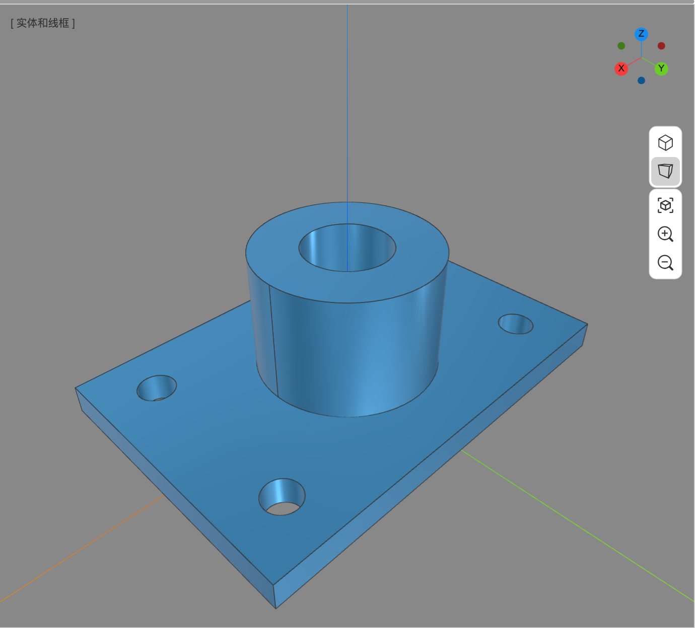

# 4. 直接建模：绘图、构造与布尔

直接建模（**基本** 标签）直接操作几何：每条命令生成一个形状节点，或用一个新形状替换旧节点，**没有参数化特征历史**。优点是快、对导入的模型同样适用；改尺寸时只能编辑属性面板实际提供的字段，或者撤销后重做、重新绘制，不能按完整的命令历史回溯修改。

需要保留可编辑特征关系时，请使用 **参数化** 标签中的参数化体，见 [第 6 章](06-parametric-modeling.md)。

*直接建模示例：底板、圆柱凸台与孔组成的法兰，结果不依赖参数化特征链。*

## 4.1 通用操作方式

- 命令启动后，状态栏会说明下一步要拾取什么。
- 拾取时悬停高亮，左键确认；需要多个对象时连续点击，`Enter`/`Space` 结束。
- `Esc` 取消当前命令或当前拾取。
- 命令面板里的选项随时可改，改完预览会刷新。
- 每完成一次命令就是一次撤销步骤（Ctrl+Z）。
- 提交前检查选中的对象、预览和会消耗源节点的选项；提交后检查结果节点与源节点是否符合预期。选错输入或误删源节点时先撤销，不要在错误结果上继续建模。

## 4.2 绘制组

### 直线（L）

拾取起点、终点。默认**连续绘制**：画完一段后自动从终点继续，按 `Esc` 或 `Enter` 结束整条链。命令面板的“相连”复选框控制这个行为。

### 矩形（R）

拾取第一个角点、对角点。也可以在拾取第一点后直接键入 `宽,高` 回车，得到精确尺寸。

### 圆（C）

拾取圆心、半径点。键入数值可直接定半径。

### 椭圆

拾取中心 → 长轴端点 → 短轴端点。三个点决定椭圆的平面、朝向和两个半轴。

### 正多边形

拾取中心、半径点。命令面板的“边数”默认为 6。

> 圆、椭圆、正多边形和多段线的命令面板里有 **“面”** 复选框：勾选（默认）生成平面片体，取消则生成线框。需要后续拉伸时，片体通常更方便。

### 圆弧（4 种）

| 命令 | 步骤 |
| --- | --- |
| 圆弧 | 圆心 → 半径 → 起始方向/扫掠角 |
| 两点圆弧 | 起点 → 终点 → 弧高（凸起方向与高度） |
| 三点圆弧 | 起点 → 弧上的点 → 终点 |
| 相切相切半径圆弧 | 选两条相邻边 → 半径 |

### 立方体（B）

拾取底面的第一个角点、对角点，再拾取高度点。长、宽、高分别对应 `dx / dy / dz`，可在属性面板修改。

### 球体（S）

拾取球心、半径点。

### 圆柱（Y）

拾取底面圆心、半径点、高度点。圆柱沿拾取平面的法向生成。

### 圆锥（N）

拾取底面圆心、半径点、高度点。

### 棱锥

拾取底面第一个角点、对角点、锥顶高度点。

> **挤出、旋转、扫掠共同注意：** 命令面板的“删除对象”默认勾选。若拾取的是完整轮廓节点，提交后整个节点会被消耗；以整个节点拾取的旋转轴或扫掠路径也会被消耗。取消勾选可保留源节点，但结果保存的是创建时的几何，之后修改源轮廓、轴或路径不会联动更新。**这不是参数化历史。** 还要后续编辑输入时请先取消勾选；误消耗源节点时立即 `Ctrl+Z`，整次命令可以一起撤销。

### 挤出（P）

直接建模的挤出是“从已有轮廓拉出几何”：

1. 选择要挤出的面、边或线框（包括草图轮廓）。
2. 沿法向拖拽箭头设置距离，或在命令面板输入数值。
3. `Enter` 确认。

与参数化拉伸不同，这里生成的是一个独立的挤出结果节点，不会进入参数化体的特征列表。挤出长度随后可在属性面板修改，但这不会改变原轮廓，也不会建立两者的联动。

### 放样 / 戈登曲面

- **放样**：按预期顺序依次选择多个截面（面、草图轮廓或闭合线框），`Enter` 结束选择。命令面板可设“实体”“直纹曲面”“连续性”“删除对象”。
- **戈登曲面**：至少 2 条轮廓边 + 2 条引导边，先选轮廓，再选引导。适合用一组交叉曲线生成曲面；提交前检查两组曲线是否形成相交网格，失败时先修正数量和交叉关系再重试。

### 扫略（扫掠）

界面按钮目前写作 `扫略`。先选**截面**（边或线框，可多选），确认后再选**路径**（一条线框或逐段拾取的连续边链）。命令面板的“圆角”控制路径拐角是否做圆滑过渡。若一直没有预览或提交失败，先检查截面是否有效、路径是否连通，再重新拾取。

### 旋转

先选截面，再选旋转轴。旋转轴必须是**直线边**，且不能把截面自身作为轴。命令面板的“角度”默认 360°，必须为非零有效数值；不足 360° 时得到一段回转体。提示无法旋转时，先检查轴、角度和截面选择，再重试。

### 折叠项：点、多段线、贝塞尔、螺旋线、管状体、文字

这些命令在“绘制”组的下拉里（组名右侧的小三角）。

- **点**：单击放置一个点。
- **多段线**：连续拾取点，可闭合；适合画折线轮廓。
- **贝塞尔**：连续拾取控制点，绘制贝塞尔曲线。
- **螺旋线**：拾取中心、半径、高度；命令面板的“螺距”控制每圈上升高度。
- **管状体**：连续拾取折线路径的点，`Enter`/`Esc` 结束；命令面板的“半径”决定管体半径。
- **文字**：命令面板设置字体、字高、内容、放置方式（选两点 / 沿路径）。按提示拾取位置、方向与深度。字体第一次使用时按需下载，不同字体有不同体积；当前字体缺字时会记录日志并跳过该字形。

## 4.3 布尔运算组

三个命令的操作完全相同，只是运算不同：

| 命令 | 结果 |
| --- | --- |
| 合并 | 目标 ∪ 工具 |
| 减去 | 目标 − 工具 |
| 交集 | 目标 ∩ 工具 |

步骤：

1. 选择**目标**实体（第一个拾取）。
2. 选择**工具**实体（可多选），`Enter` 结束。
3. 命令面板的“保留操作对象”：
   - 不勾选（默认）：目标和工具都被结果节点替换。
   - 勾选：工具实体保留在场景中，目标被结果替换。

布尔失败时会弹出错误提示，原节点保持不变。如果某个实体被“实例”引用，它不能被消耗，命令会拒绝并提示先删除实例或对实例执行 `使独立`。

## 4.4 转换组

| 命令 | 作用 |
| --- | --- |
| 转多段线 | 把选中的边/线框转成一个线框节点 |
| 转组合体 | 把多个形状合成一个组合体（不融合，内部仍分离） |
| 转为面 | 用选中的边/线框围成一个面 |
| 转为壳 | 把选中的面缝合成壳 |
| 转为体 | 把闭合的壳转为实体 |

注意：转换命令会**替换**原来选中的节点（原节点被删除，结果接管）。转换前建议先保存或确认可以撤销。

## 4.5 工具组

| 命令 | 说明 |
| --- | --- |
| 曲线投影 | 选一条曲线，再选一个面，按“方向”（默认 `0,0,-1`）投影到面上，得到一条投影曲线 |
| 创建组 | 把可编组对象组合为整体（不是项目树文件夹）；实例及其源、被标注引用的节点等不能这样编组，命令会提示并保持其独立 |
| 相交曲线 | 选两个形状，得到它们的交线 |
| 偏移 | 选边/线框/面，再沿法向拾取距离；连接类型可选圆弧/相切/相交 |
| 复制形状 | 选若干边或面，复制成独立节点，保持原位置与变换 |
| 修复形状 | 对选中形状运行 ShapeFix，修复常见拓扑问题 |
| 检查形状 | 逐面检查有效性，弹出对话框列出每个面的检查结果 |

`创建组` 会要求设置组件名称和插入点，把选中对象移入组件定义，并可生成组件节点。组件使用创建时冻结的合并网格，不是随源几何继续联动的普通文件夹；只需要整理项目树时，应改用项目树工具栏的文件夹。实例及其源、被标注引用的节点、已被特征消耗的工具等不能这样编组。

“修复形状”和“检查形状”在“工具”组的下拉里。

## 4.6 直接建模的编辑方式

直接建模节点不一定保留原命令参数。属性面板只能编辑它实际列出的字段，以当前选中节点的显示为准：

- **可直接修改的示例**：立方体的位置、长、宽、高；圆柱的圆心、半径、高度；圆的圆心、半径；矩形的宽、高；挤出的长度。
- **未暴露原命令输入的示例**：直接旋转结果不提供轮廓、轴和角度字段；扫掠结果不提供截面、路径和拐角选项字段。
- 放样/戈登结果、导入形状、直接圆角/倒角后的修形结果，同样没有原命令参数列表可供继续编辑。

对可编辑字段的修改会立刻重建该节点，并算作一次撤销步骤。对未暴露原命令输入的结果，只能撤销后重做，或使用参数化体重建；不能修改源轮廓后期待结果联动。若要回到一串操作中的某一步，使用撤销/重做，而不是期待直接建模具有参数化历史。

---

下一步：[第 5 章 修改、测量与注释](05-modify-convert-measure.md)
