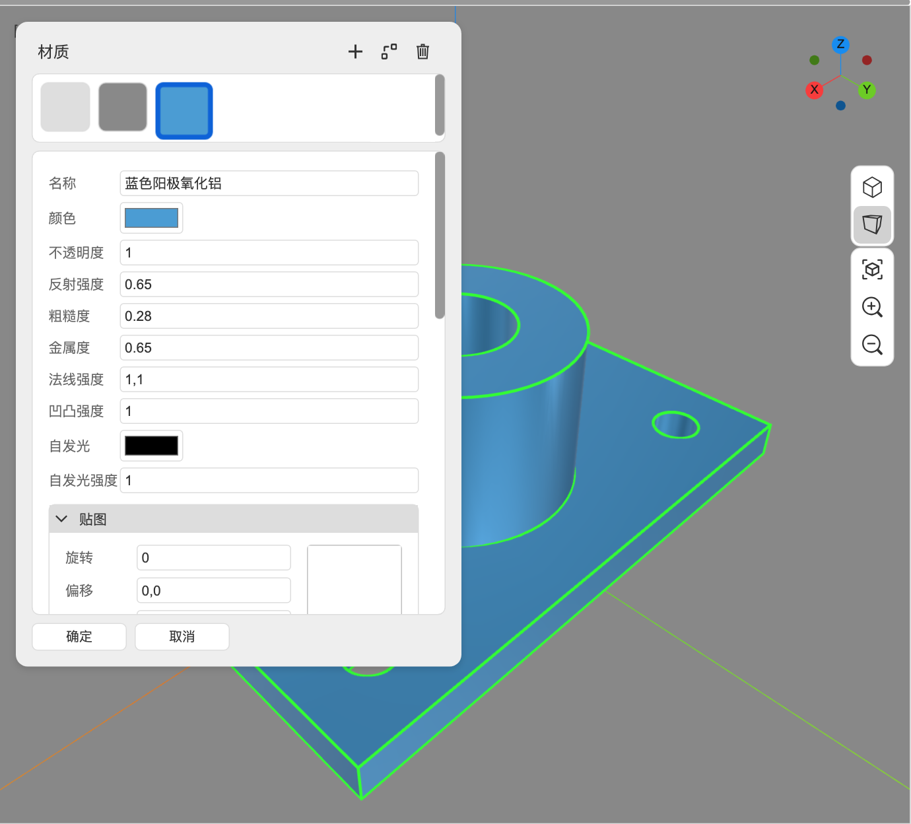
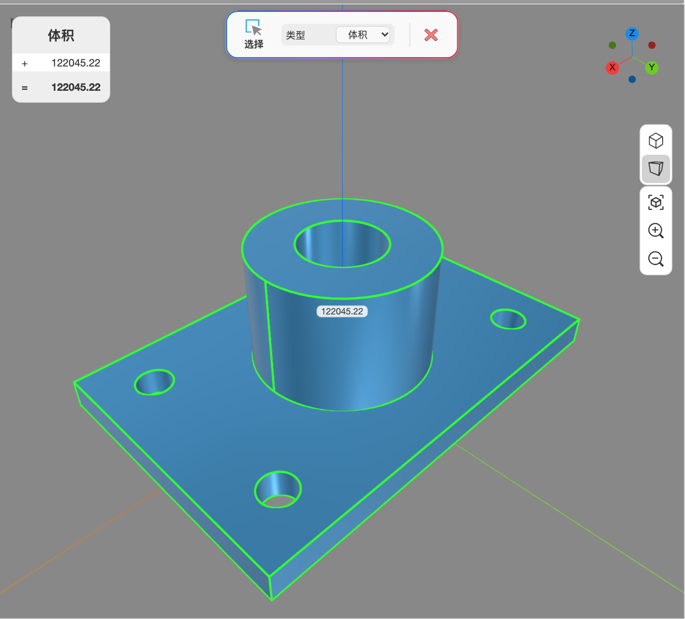

# 5. 修改、测量与注释

这一章覆盖 **基本** 标签右半部分的命令：修改、测量、注释、场景，以及材质编辑器。大多数命令都遵循同一套“选对象 → 设参数 → 确认”的流程。

## 5.1 变换：移动、旋转、镜像、阵列

移动、旋转、镜像时勾选 `复制对象`，以及执行阵列，对参数化体、直接建模生成的参数化形状（如立方体、旋转/扫掠结果）和普通可编辑形状生成的是**关联实例**，不是完全独立的几何副本。实例可以各自摆放，但仍读取源节点的几何；修改源的尺寸、形状或特征，实例会跟随变化。

只需要编辑某一个副本时，先选中实例，在属性面板的“源节点”区域点 `使独立`，或使用 **参数化 → 节点操作 → 使独立**。若误改源导致多个实例一起变化，立即撤销这次源修改，再对需要单独编辑的实例执行 `使独立`。

### 移动（M）

1. 先选中要移动的节点（不选也行，命令会提示你选）。
2. 点 `移动`，拾取**基点**，再拾取**目标点**。
3. 两点之间的位移就是移动量。拾取时状态栏会显示距离。
4. 命令面板的 `复制对象` 勾选后，保留原件并生成一个副本。

### 旋转（Shift+R）

1. 选中对象，点 `旋转`。
2. 拾取旋转中心 → 拾取决定旋转平面的参考点 → 拾取角度点。
3. 命令面板同样有 `复制对象`。

### 镜像

1. 选中对象，点 `镜像`。
2. 在视口里拾取**镜像线的两个点**：第一点落在镜像线上，第二点决定镜像线的方向（镜像面垂直于当前工作平面）。
3. 命令面板的 `复制对象` 决定保留原件还是原地镜像。不勾选时，原对象会被镜像结果替换。

### 阵列（Shift+A）

`阵列` 支持四种类型（命令面板的“阵列类型”）：

| 类型 | 参数 |
| --- | --- |
| 线形阵列 | 方向线、数量、总长（间距随拖拽/总长确定） |
| 环形阵列 | 中心轴、总角度、数量、均布 |
| 沿曲线阵列 | 路径曲线、数量 |
| 矩形阵列 | X/Y/Z 方向的数量（间距随拖拽确定） |

- **数量**：通常包含源对象。对关联实例而言，就是源对象加“数量 − 1”个实例；矩形阵列按 X × Y × Z 个位置计算。不要把数量误解为“额外新增”的副本数。
- `组`：结果不含关联实例时可以编组；结果含实例时，即使勾选也会提示无法这样编组，并保留为独立节点。提交后以项目树中的实际结果为准。
- 阵列方向通常通过拾取一条边或轴来确定。
- 普通独立节点会被阵列结果替换；上述关联实例的源节点会保留，作为实例定义的出处。

提交前检查预览中的数量、间距和方向；结果不符时，`Ctrl+Z` 撤销整次阵列后重新设置，避免逐个清理错误副本。

## 5.2 边角与抽壳

### 圆角（Shift+F）

1. 点 `圆角`，选择一条或多条**边**。
2. 命令面板设置 `半径`。
3. 回车确认。预览会随半径实时更新。

直接建模的圆角用新的修形结果替换原形状。

### 倒角（Shift+C）

选择边，设置 `长度`，确认。倒角与圆角一样替换原形状。

圆角/倒角结果不在属性面板暴露原来的半径、长度和选边列表。若预览消失或提交失败，先确认数值大于零，再尝试减小半径/长度、减少同时选择的边；已提交但结果不符时，`Ctrl+Z` 恢复原形状后重试。需要持续编辑这些尺寸时，应改用参数化体。

### 抽壳

1. 选择实体。
2. 选择要**开口**的面（可多选，`Enter` 结束）。
3. 设置 `厚度`；`向外` 决定加厚方向，`连接类型` 决定相邻面如何接合。
4. 确认。

## 5.3 修剪、延伸、打断、分割

### 修剪（T）

`修剪` 是一个连续命令：

1. 点 `修剪`。
2. 直接点要**删掉的那一段**边。命令会计算它与其他边的交点，删掉该段，保留其余段。
3. 可以继续点其他段；`Esc` 结束。

### 延伸

1. 点 `延伸`，选择要延伸的边。
2. 选择延伸到的边界边。
3. 命令面板的 `同时修改边界` 决定是否把边界一起改短/改长。

### 打断

选择一条边，再在边上拾取一个点，边会在该点处断成两段。

### 分割

1. 选择要分割的形状。
2. 选择切割工具：边、线框或面（可多选）。
3. 确认后，原形状被切成多个节点。

### 缝合 / 简化

- **缝合**：把多块面/壳体按 `容差` 缝合成一个整体。
- **简化**：移除共面/共线的边和面；命令面板可分别勾选 `移除边`、`移除面`。

### 分解

选择组合体、多形状节点或组件，`分解` 会把它的直接子形状拆成独立节点。

## 5.4 删除的三种含义

这三个命令很容易混：

| 命令 | 作用 |
| --- | --- |
| `删除`（Delete / Backspace） | 删除选中的整个节点 |
| `删除子元素` | 选择形状上的边或面，只删掉这些子元素，并重建节点 |
| `删除特征` | 选择某个特征生成的面（例如圆角的圆角面），移除该特征并愈合周围几何 |

后两个会**替换**节点（结果是一个愈合后的新形状），靠撤销回去。

## 5.5 画笔与材质

### 油漆桶

选中若干节点，点 `油漆桶`，在命令面板选择材质，确认后整个节点换成该材质。若节点上原有逐面材质，会一并清除。

### 添加画笔 / 删除画笔 / 清除画笔

- `添加画笔`：选择面（可多选），命令面板选材质，只给这些面换材质。
- `删除画笔`：选择面，移除这些面的单独材质，恢复节点材质。
- `清除画笔`：选择节点，清除它所有逐面材质。

这几个命令在“修改”组的下拉里。

## 5.6 材质与外观

选中对象后，属性面板的“材质”行显示当前材质。点击材质色块打开材质编辑器：

*材质参数直接对应视口中的外观；图中为自定义蓝色金属材质。*

编辑器包含：

- **材质列表**：顶部色块，点选切换；`+` 新建（空白材质或预设），复制、删除。
- **名称、颜色、不透明度**。
- **反射强度、粗糙度、金属度**：PBR 参数。
- **法线强度、凹凸强度**。
- **自发光、自发光强度**。
- **贴图**：基色贴图、法线贴图、粗糙度贴图、金属度贴图、凹凸贴图、自发光贴图；每张贴图可设置旋转、偏移、重复和环绕方式，图片可直接从文件载入。

点 `确定` 应用，`取消` 放弃。修改材质是一个撤销步骤。

## 5.7 测量

### 长度（D）

拾取两个点，视口浮出两点距离。拾取时可以使用所有捕捉类型。

### 角度

拾取**顶点** → 第一条边上的点 → 第二条边上的点。视口显示角度（度）。

### 选择（汇总）

1. 点 `测量 → 选择`。
2. 命令面板的 `类型` 选长度 / 面积 / 体积。
3. 逐个拾取要统计的形状。视口左上角出现浮层，列出每一项的数值和累计值。
4. `Esc` 退出时浮层消失；需要保留结果可先截图。

*“选择”测量同时列出每项体积与累计体积，图中数值的单位为立方毫米。*

## 5.8 注释

注释是**视图内标注**，不改变几何，随文档保存。

| 命令 | 步骤 |
| --- | --- |
| 尺寸 | 拾取两个点 → 拾取标注线位置；拖动时按坐标轴方向推断标注平面 |
| 半径 | 拾取圆/圆弧边 → 拾取引线位置 |
| 直径 | 同上，显示直径 |
| 角度 | 拾取两条直线边 → 拾取标注位置 |
| 文字 | 拾取引线指向的点 → 拾取文字位置，然后输入文字 |

- 标注命令面板可设置 `文字高度`。
- 标注引用的几何在重建后找不到时，标注会保留在最后位置，并给出提示。
- 被标注引用的节点不能直接编组；命令会拒绝并保留独立节点，以免标注失去引用。

## 5.9 场景（视角书签）

**基本 → 场景 → 从相机创建** 把当前视角保存成一个书签：

1. 调整好相机。
2. 点 `从相机创建`。
3. 视口底部中央出现书签；点它相机飞回该视角。
4. 书签右侧齿轮重命名，`×` 删除。

## 5.10 直接建模改参数 vs 重新命令

- 对单个节点改尺寸：只有属性面板实际列出对应字段时才能直接改，例如立方体尺寸或挤出长度。
- 对布尔、圆角/倒角等修形结果，以及直接旋转、扫掠、放样/戈登等未暴露原命令输入的结果：只能撤销后重做，或用参数化体重建。
- 对导入的模型做局部修改：用 `删除子元素`、`删除特征`、`修复形状`、`简化` 等命令；它们不会补回原模型的建模历史。
- 修改前若不能确定节点是否保留所需字段，先选中它检查属性面板；已经误改时用 `Ctrl+Z` 恢复，再继续下一步。

---

下一步：[第 6 章 参数化建模](06-parametric-modeling.md)
