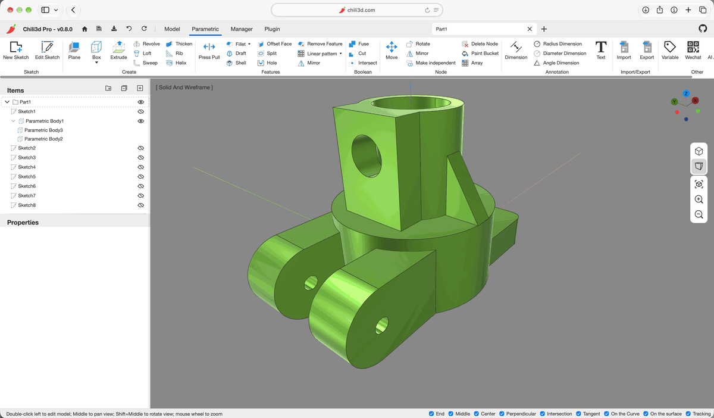
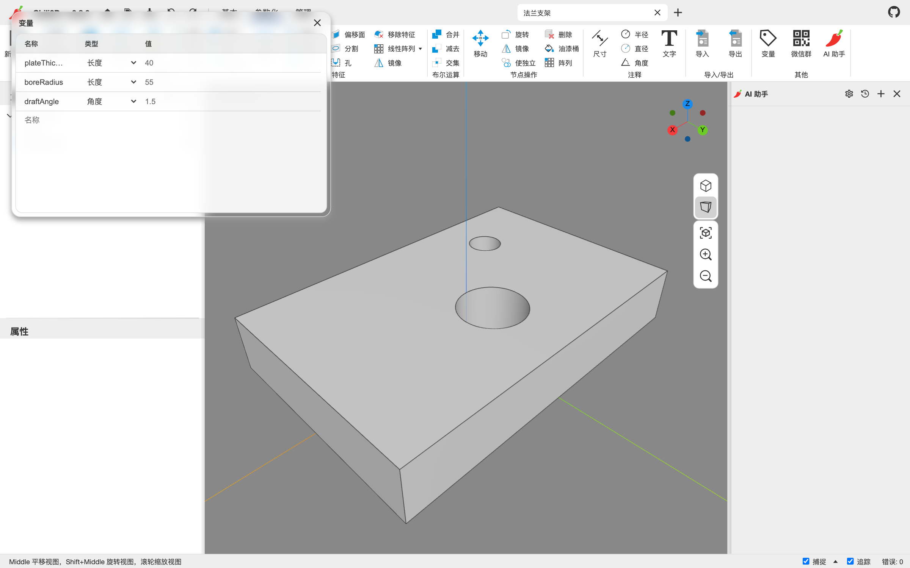

# 6. 参数化建模

参数化实体（Parametric Body）是 Chili3D 的“设计树”模型：实体本身不保存最终几何，只保存一条**有序特征列表**。每次修改或重建时，列表从上到下重新执行一遍，因此改上游特征会自动带动下游。

*复杂参数化零件示例：修改上游草图尺寸后，特征链会重新求值（英文界面）。*

## 6.1 参数化体和特征链

- 一个参数化体在项目树中显示为 `参数化实体1`，它下面藏着被消耗的草图、工具实体等输入。
- 选中实体后，属性面板出现 **特征** 折叠区，每行是一个特征（拉伸、孔、圆角……）。
- 调整顺序：拖动特征行的标题即可重排。
- 特征行左侧的图标表示类型，右侧 `⋯` 打开菜单。

### 特征行菜单

| 菜单项 | 作用 |
| --- | --- |
| 重命名 | 修改特征显示名 |
| 重新选择 | 该特征支持的引用失效时，重新拾取；可重选的对象随特征而异 |
| 抑制 / 取消抑制 | 暂时跳过该特征，保留它在列表中的位置 |
| 按变量抑制… | 指定一个文档变量：变量解析为 0 时抑制该特征，可勾选“变量非零时抑制”反向 |
| 删除 | 从特征链中移除该特征并重建 |

### 展开与参数

点特征行（不是 `⋯`）展开，行内出现：

- 该特征自己的参数输入框；
- 缺失的输入（`缺失的输入 #n`）与引用列表；
- 错误/警告文字；
- “依赖于 / 被用于”的关系行，点名称可跳到对应特征。

参数编辑在失焦或回车时提交，一次编辑就是一个撤销步骤。

### 回滚条

特征列表行与行之间有细横线（回滚槽）。点击某条槽，模型只重建到该位置，后面的特征变灰（但仍保留）。再次点击或拖动回滚条可以恢复。适合查看“做到某一步时是什么样”。

### 失败处理

某个特征失败时，视口保留的是**最后一次完整特征链成功重建**的结果，而不是本次失败前已经算出的特征前缀。错误参数或表达式也会写入特征，所以“画面没动”既不代表编辑没保存，也不代表参数有效。建议按以下顺序恢复：

1. 如果失败来自刚提交的编辑，先执行一次 **撤销**（默认快捷键 `Ctrl+Z`），撤回这次错误编辑，再小步修改；重建失败不会自动回滚已写入的参数。
2. 从特征链最上方的**第一条错误**修起。修好并重建后，再检查后续错误，不要先围着由它引起的下游故障调整。
3. 对 `缺失的输入` 使用 **重新选择**；需要确认某个特征所依据的前置形状时，用回滚条定位，检查完再恢复完整链。
4. 确认特征确实不再需要后，最后才考虑抑制或删除。它们也会改变几何，可能让下游引用进一步失效。

引用的面、边、顶点或草图在重建后找不到时，特征行会提示。部分特征会暂用最后保存的引用位置或其他回退值继续建模，因此旧形状可能仍在；应及时重新选择，不能据此认定引用和参数都健康。

### 引用为什么稳定

下游特征引用的面、边、顶点和草图轮廓是按**跟踪标识**保存的，而不是按索引。上游改动导致拓扑变化时，引用会尽量重新匹配；匹配不到时才需要“重新选择”。

## 6.2 创建参数化体

### 从草图开始

1. **参数化 → 新建草图**，选基准面（红/绿/蓝方块）或实体上的平面。
2. 在草图里画闭合轮廓。
3. 退出草图，选中草图，点 **拉伸 / 旋转 / 放样 / 扫掠**。
4. 设置参数，确认。第一个特征会创建参数化体。

一个草图里有多个闭合轮廓时，拉伸会同时拉伸它们；内环会成为孔。

### 从图元开始

**参数化 → 创建立方体/圆柱/球体/圆锥** 会直接创建一个参数化体，第一个特征就是该图元。命令面板的 `操作` 可以是新建、加入、移除、相交，`目标实体` 选择已有体。

### 基准面

**参数化 → 基准面** 创建可复用的基准面节点，类型：

| 类型 | 定义方式 |
| --- | --- |
| 偏移面 | 相对一个已有平面偏移距离 |
| 过点平行面 | 通过一点且平行于某平面 |
| 线角度 | 绕一条线旋转一个角度 |
| 过点法向 | 通过一点、给定法向 |
| 三点 | 通过三个点 |
| 中面 | 两个平行平面的中间面 |
| 曲线点 | 过曲线上一点且垂直于曲线 |

基准面可用于草图平面、镜像平面、拔模中性面等。

## 6.3 构造类特征

### 拉伸

- 轮廓：草图轮廓面，或实体上的平面。
- `操作`：新建 / 加入 / 移除 / 相交。
- `深度`：给定深度时主方向的距离，可直接键入表达式。
- `深度 2`：创建后展开特征行可见；未勾选 `对称` 时，在主方向的反侧再拉伸这段独立距离。必须为正值，与 `对称` 互斥。
- `对称`：主侧按 `深度`（或终止条件）拉伸，另一侧也走同样的**完整距离**，不是把深度对半分。例如给定深度为 10 时，轮廓两侧各拉伸 10，总厚度为 20。
- `反向`：翻转主拉伸方向。
- `起始偏移`：从轮廓平面偏移一段再开始。
- `终止偏移`（到面/到点时可用）：正值沿实际拉伸方向越过目标，负值在到达目标前停下。
- `拔模角度`：侧壁的锥度。

`终止条件` 的行为如下：

| 选项 | 终止方式 |
| --- | --- |
| 给定深度 | 用 `深度` 决定主方向的长度 |
| 完全贯穿 | 自动越过**当前参数化体在此特征之前**的形状；需要前置特征，不是贯穿文档里的所有实体，也不计入此特征之后的形状 |
| 到面 | 以拾取的面为限，停在沿拉伸方向先到达的近侧；参数允许时，端面会贴合目标曲面 |
| 到点 | 以拾取的顶点确定终点，使终止位置通过该点 |

`到面` 的曲面贴合主要用于**单个草图轮廓**，且没有起止偏移、对称、深度 2 或拔模；操作可以是新建、加入或移除。多个轮廓、相交操作、目标引用只能使用冻结几何，或内核无法完成曲面贴合时，会退回按近侧距离生成平面端盖。看到平面端盖时，应检查这些条件和特征行的警告。

选择“到面/到点”后，单击只是选定目标，还要按 `Enter` 或确认按钮完成目标拾取。目标位于当前方向背后时，会自动朝目标反向；目标在起始面上、跨越起始面，或偏移使终点退回起点之前，则会报错。

### 旋转

选择轮廓和旋转轴，设置 `角度`（默认 360°）、`对称`、`角度 2`（双向旋转）、`操作`。

### 放样

依次选择多个截面，设置 `实体`、`直纹曲面`、`连续性`、`操作`。截面顺序决定放样方向。

### 扫掠

选择截面后逐段拾取路径边，最后确认。路径可以由多段边组成，但这些边必须属于**同一个节点**，并能首尾连接成一条线框。

- `操作`：新建 / 加入 / 移除 / 相交。
- `圆角`：控制**路径拐角**的过渡是否圆滑，不是给截面轮廓倒圆角。
- `轮廓控制`：创建后可在特征行中编辑，包括 `Frenet 标架`（默认）、`校正 Frenet 标架` 和 `固定方向`。

`固定方向` 会自动把世界 `+Z` 投影到轮廓平面，作为保持不变的参考方向；轮廓平面水平时改用世界 `+Y`。不需要再拾取方向。

### 加厚

把面或壳加厚成实体：`厚度`、`厚度 2`、`对称`、`反向`、`操作`。

### 螺旋线

设置 `半径`、`长度`、`螺距`。螺旋线可以作为扫掠路径。

### 筋

选择开放的边线链作为筋的位置，设置 `厚度`、`操作`，`延伸到零件` 决定筋是否延伸直到碰到实体。

## 6.4 修饰类特征

### 推拉（Q）

推拉是一个“智能入口”，根据你拾取的对象决定打开哪个特征命令：

| 拾取 | 拖拽结果 |
| --- | --- |
| 草图轮廓面 | 拉伸（拖出距离，方向/端部决定新建、加入或切除） |
| 实体平面 | 偏移面 |
| 圆角/倒角特征生成的面 | 修改对应圆角/倒角 |
| 边 | 正距离 = 圆角，负距离 = 倒角 |

拖动箭头或在命令面板输入数值，回车提交。推拉一次只处理一类对象（面或边）。

### 孔

**孔** 是减材特征，必须依附已有参数化体，并且该体在孔特征之前已经有形状；不能把孔作为空特征链的第一个特征。

可以用两种方式放置孔心：

1. **直接在面上拾取**：单击参数化体的平面作为 `钻孔面`，再在面上单击一个或多个孔心，按 `Enter` 或确认按钮结束。孔心必须落在该面范围内。
2. **绑定草图独立点**：单击可见草图中用 **点** 工具创建的一个或多个非构造独立点，再确认。绑定点必须来自**同一草图**；移动或重新约束这些点后，孔心会随点更新并投影到钻孔面。程序会尝试从草图平面推断共面的钻孔面；找不到合适面时，保留已选点并手动单击钻孔面，再完成孔心拾取。

在结束拾取前，于命令面板中设置 `类型` 和尺寸。三种类型共用 `直径`、`深度（留空 = 贯通）` 和 `钻尖角`，其余参数为：

| 类型 | 专用参数 | 形状 |
| --- | --- | --- |
| 简单 | 无 | 直钻孔，盲孔底部带钻尖 |
| 沉孔 | `沉孔直径`、`沉孔深度` | 孔口有圆柱形沉台 |
| 锥沉孔 | `锥沉孔直径`、`锥沉孔角度` | 孔口有锥形沉面 |

深度和钻尖的约定：

- **新建孔时深度留空即为贯通**，会穿过当前实体；填入正值则创建盲孔。
- 盲孔 `深度` 从钻孔面量到**钻尖尖端**，已经包含钻尖，不是只量圆柱直壁；因此深度必须大于钻尖自身的高度。
- `钻尖角` 是钻尖的包含角，默认 **118°**。

尺寸还必须满足：钻孔直径为正；钻尖角和锥沉孔角度均在 0° 到 180° 之间；沉孔直径、锥沉孔直径都要大于钻孔直径；沉孔深度为正；沉孔深度或锥沉面高度都必须小于钻孔圆柱直壁的长度，不能把直壁全部占掉。

#### 孔规格预设

创建孔以后，展开它的**特征行**，在 `预设` 下拉框中选择规格。可选尺寸为 `M3`、`M4`、`M5`、`M6`、`M8`、`M10`、`M12`、`M14`、`M16`、`M20`。

- **简单**：每个规格提供 `close` / `normal` / `loose` 三档间隙孔径。
- **沉孔**：使用普通间隙孔径，并填入相应的头部容纳直径和沉孔深度。
- **锥沉孔**：使用普通间隙孔径，并填入相应的头部容纳直径和 90° 锥角；**M14 没有锥沉孔预设**。

例如 M8 普通间隙：

- 简单孔选择 M8 的 `normal` 档，钻孔直径为 **9**；
- 沉孔选择 M8 的 `⌀9 / ⌀14×8` 预设，钻孔直径为 **9**，沉孔直径为 **14**、深度为 **8**；
- 锥沉孔选择 M8 的 `⌀9 / ⌀17.92×90°` 预设，钻孔直径为 **9**，锥沉孔直径为 **17.92**、角度为 **90°**。

预设只把数值写入相应尺寸字段，之后仍可自行修改；它**不生成螺纹，也不是攻丝底孔表**。

孔心引用丢失时，特征行的 **重新选择** 只会重新拾取孔心，不能更换钻孔面。若钻孔面本身已经丢失，需要重新创建孔特征。

### 圆角

选择边（可多选），设置 `半径`。`末端半径` 留空表示等半径；填入不同值可做变半径圆角。确认后生成一个圆角特征。

### 倒角

选择边，选择模式：

| 模式 | 参数 |
| --- | --- |
| 等距离 | 距离 |
| 双距离 | 距离 1、距离 2 |
| 距离和角度 | 距离、角度、翻转方向 |

### 修改圆角 / 修改倒角

选择由某个圆角/倒角特征生成的面，直接修改该特征的半径/距离。这通常比删掉特征再重做更能保留设计意图，并减少下游引用失效；但半径或距离导致拓扑改变时，仍应检查下游特征。

### 拔模

1. 选择中性面（基准面或实体平面）——拔模绕它旋转。
2. 选择要拔模的面（可多选）。
3. 设置 `角度`；`反向` 翻转倾斜方向。

### 抽壳

选择要开口的面，设置 `厚度`、`向外`、`连接类型`。实体被挖空成薄壁。

### 偏移面

选择要移动的面（可多选），设置 `距离`。`保持圆角半径` 用于面旁边有圆角的情况：勾选后会先移除圆角、移动面、再按原半径重建圆角（否则圆角半径会跟着面一起变，并把后面的面拖走）。

- 不是实体、或有封闭内腔、或平滑面上有尖边时，命令会拒绝并说明原因。
- 距离设得太大时，命令会报告“太远”的大致上限。

### 分割

选择一个实体和分割工具（面/边/线框），设置 `保留侧`：两侧 / 法向侧 / 对侧。

### 阵列

三种参数化阵列：

| 命令 | 参数 |
| --- | --- |
| 线性阵列 | 方向 1、间距、数量；勾选方向 2 后可设间距 2、数量 2；跳过实例在特征行里编辑 |
| 环形阵列 | 阵列轴、总角度、数量、均布 |
| 曲线阵列 | 路径、间距或均布、取向（锁定 / 沿切线） |

### 镜像

选择镜像平面（基准面或实体平面），`合并` 决定镜像结果是否与原体合并。

### 布尔

- **合并**：目标 ∪ 工具
- **减去**：目标 − 工具
- **交集**：目标 ∩ 工具

工具实体不会被删除，而是**隐藏并挂到实体的特征列表下**，作为该布尔特征的输入。要修改或删除它们，通过特征列表操作。

### 移除特征与重新选择

- `移除特征`：选择一个由某特征生成的面（如圆角面），把该特征从链中移除并愈合。
- `重新选择`：特征引用的几何丢失时使用；也可以从特征行菜单进入。

## 6.5 体与节点操作

- **移动 / 旋转 / 镜像**：对参数化体做**刚体变换**，变换会作为一个 `transform` 特征追加到特征链末尾（阵列、复制生成的则是实例节点）。
- **阵列**：生成多个实例或组；实例共享源几何，修改源会影响所有实例。
- **使独立**：把实例（instance）变成拥有独立几何的副本；修改副本不影响源。
- **删除**：删除整个体及其特征链。
- **油漆桶**：给整个体换材质。

草图不能被移动——它定义在世界坐标里，位置由创建时的基准面决定。要移动设计，移动体本身或修改草图/特征参数。

## 6.6 文档变量

**参数化 → 其他 → 变量**（或 `feature.variable`）打开文档级变量表：

| 列 | 说明 |
| --- | --- |
| 名称 | 变量名，必须匹配 `[A-Za-z_][A-Za-z0-9_]*`，不能与常量 `pi`、`e` 重名 |
| 类型 | 长度 / 角度 / 无量纲 |
| 值 | 聚焦时编辑表达式，失焦后显示解析值或错误 |
| 描述 | 名称旁的小标记里编辑，可选 |

操作：

- 在表格**底部空白行的“名称”框**输入新变量名，失焦或按 `Enter` 即可新增；不是用标题栏 `+`。新行默认为长度类型、表达式为 `0`。
- 选中已有行后，可用标题栏按钮删除、上移、下移。
- 名称、表达式等字段在失焦或按 `Enter` 时立即提交并触发相关草图和实体重建；面板没有统一的“确定”步骤，关闭面板也不会撤销修改。每次提交是一个撤销步骤。
- 变量按顺序求值，**只能引用它上面的变量**，因此不会出现循环。
- 拖动表头边缘可以调整“名称/类型”列宽，也可以用方向键微调。
- **错误表达式也会原样保存**。失败行标红且不产生可供引用的值；不依赖它的独立行仍会求值，但引用这个失败变量的下游变量也会失败。

表达式支持：

- 数字、其他变量名、`+ - * / %`、括号；不支持 `^` 幂运算符，也不要写 `mm` 等单位后缀；
- 常量 `pi`、`e`；
- 函数 `abs`、`sqrt`、`floor`、`ceil`、`round`、`min`、`max`、`sin`、`cos`、`tan`、`asin`、`acos`、`atan`、`atan2`；
- 角度一律用度：`sin(30)` 是 0.5，`sin(90)` 才是 1，`sin(pi/2)` **不是** 1；
- 类型会检查：长度变量不能直接放进角度槽位，`sqrt` 要求输入的量纲指数为偶数。

假设 `width`、`height` 是长度变量，`tilt` 是角度变量，可用以下量纲表达式：

| 表达式 | 结果类型与用途 |
| --- | --- |
| `width*2` | 长度，例如把总宽定义为宽度的两倍 |
| `width/height` | 无量纲比值 |
| `sqrt(width*height)` | 长度，即长度平方所构成面积的平方根 |
| `width*cos(tilt)` | 长度，即宽度在倾斜方向上的投影 |
| `atan2(height,width)` | 角度；参数顺序是先 y、后 x |

在特征参数或草图尺寸里直接输入变量名或表达式即可，例如 `深度 = plateThickness * 2`。

### 按变量抑制

特征行菜单 → `按变量抑制…`，选择一个变量：

- 变量解析为 0 时抑制该特征；
- 勾选“变量非零时抑制”则反过来；
- 变量不存在或解析失败时，**不会抑制特征**，只在特征行显示警告。

被变量抑制的行有单独的颜色，和手动抑制区分开。

---

下一步：[第 7 章 草图](07-sketch.md)
