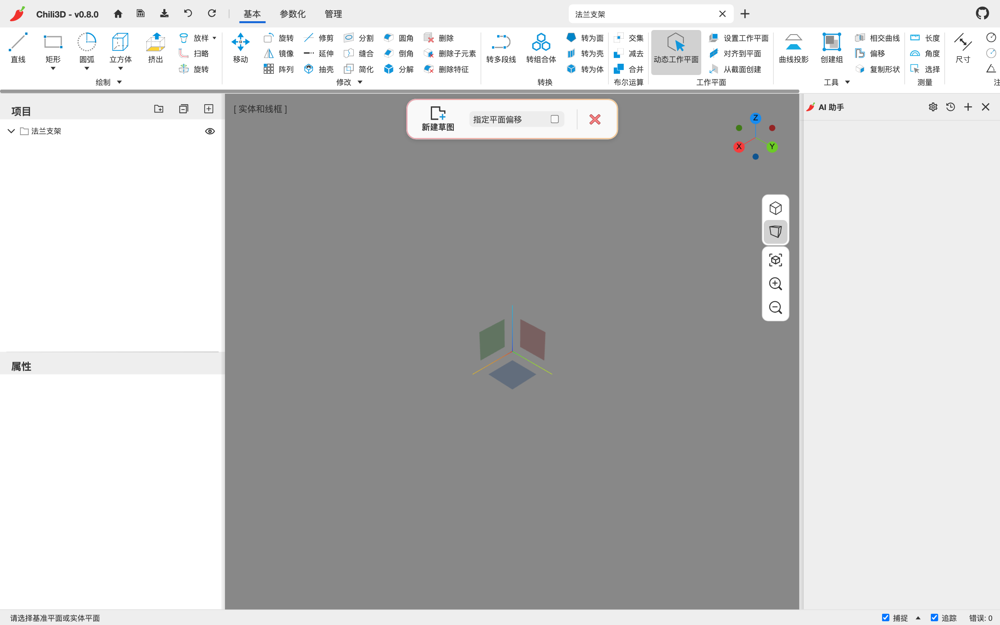
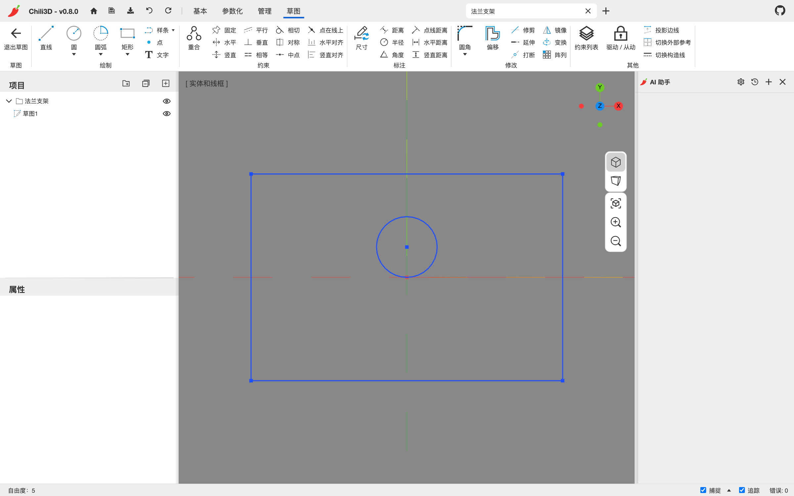
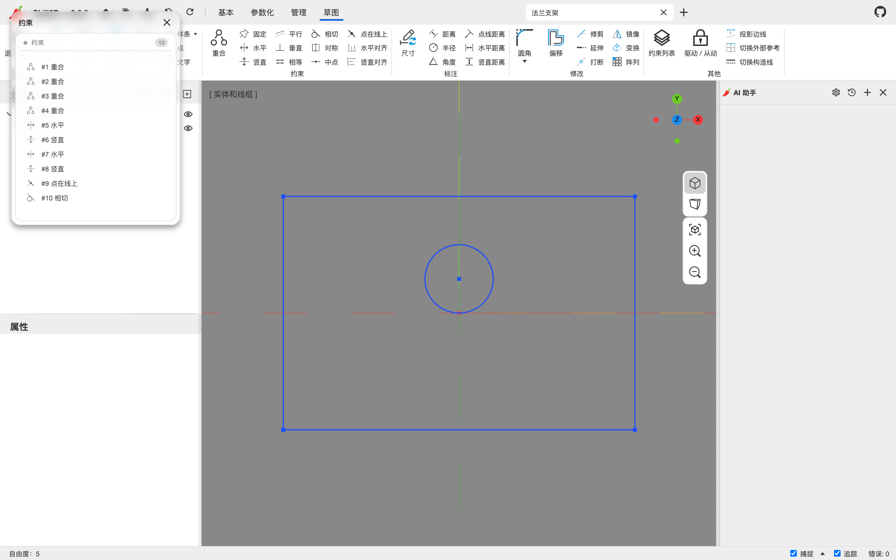

# 7. 草图

草图是参数化建模的源头：二维轮廓 + 约束 + 尺寸，之后被拉伸、旋转、扫掠或放样成实体。草图由内置的 garlic 约束求解器实时求解。

## 7.1 新建与编辑草图

1. **参数化 → 新建草图**。
2. 选择基准面：
   - 视口中央出现红/绿/蓝三个半透明方块，分别对应 YZ / ZX / XY 世界基准面；
   - 也可以点实体上的平面，以该面为草图平面。

   

3. 草图编辑器打开：相机转到正对草图平面的正交视图，旋转被锁定，实体面被隐藏，功能区切换到 **草图** 上下文标签。

   

4. 画图、加约束、加尺寸。
5. **草图 → 退出草图**，或按 `Esc` 逐层退出。

重新编辑：

- 选中草图，点 **参数化 → 编辑草图**；或
- 在项目树/视口里双击草图节点。

> 草图属于世界坐标，不能像实体那样拖动。要改变草图位置，修改创建时的基准面、或使用草图的“变换”工具移动草图内的几何。

## 7.2 草图标签

| 组 | 内容 |
| --- | --- |
| 草图 | 退出草图 |
| 绘制 | 直线、圆/椭圆、圆弧/椭圆弧、矩形/多边形、样条/贝塞尔/圆锥（下拉）、点、文字 |
| 约束 | 重合、固定/水平/竖直、平行/垂直/相等、相切/对称/中点、点在线上/水平对齐/竖直对齐 |
| 标注 | 尺寸（智能）、距离/半径/角度、点线距离/水平距离/竖直距离 |
| 修改 | 圆角/倒角、偏移、修剪/延伸/打断、镜像/变换/阵列 |
| 其他 | 约束列表、驱动/从动切换、投影边线/切换外部参考/切换构造线 |

## 7.3 绘图工具

每个绘图命令都接受“构造线”选项（命令面板里的复选框）：勾选后画出的是参考几何，显示为虚线，可以参与约束和捕捉，但不参与轮廓。

| 命令 | 绘制方式 |
| --- | --- |
| 直线 | 连续拾取点；`Enter`/`Esc` 结束链 |
| 圆 | 圆心 → 半径点 |
| 椭圆 | 圆心 → 长轴端点 → 短轴端点 |
| 圆弧 | 圆心 → 起点 → 终点（逆时针扫掠） |
| 椭圆弧 | 椭圆（圆心/长轴/短轴）→ 起点 → 终点 |
| 矩形 | 两个对角点；自动生成 4 条线 + 水平/竖直 + 重合约束 |
| 多边形 | 圆心 → 半径点；面板设置 `边数`、`外切/内接` |
| 样条 | 连续拾取控制点 |
| 贝塞尔 | 4 个控制点，三次贝塞尔 |
| 圆锥 | 起点 → 终点 → 控制点 → 肩点（决定 rho） |
| 点 | 单击放置 |
| 文字 | 拾取锚点 → 拾取顶部点（决定高度与朝向）；面板设置内容、字高、字体 |

绘图时状态栏给出尺寸读数，也可以直接键入长度/角度。

### 自动约束与磁性捕捉

- 画线时接近水平/竖直，会自动加**水平/竖直**约束。
- 端点接近另一实体端点/曲线时，会自动加**重合**或**点在线上**。
- 接近相切时自动加**相切**约束。
- 拖动草图点时同样有磁性捕捉，约束在拖动结束时落下。
- 自动约束只在合理时添加：例如把圆的圆心钉在它自己身上会被拒绝。

## 7.4 约束

约束决定几何之间的相对关系。执行命令后按状态栏提示选择实体/点；不满足条件时会给出提示（例如“中点约束已把该点固定在这条线上，无需再加点在线”）。

| 约束 | 作用 |
| --- | --- |
| 重合 | 两个点重合 |
| 固定 | 钉住选中点的当前 X、Y 两个坐标 |
| 水平 | 直线水平 |
| 竖直 | 直线竖直 |
| 平行 | 两条线平行 |
| 垂直 | 两条线垂直 |
| 相等 | 等长/等半径 |
| 相切 | 曲线相切 |
| 对称 | 两点/两线关于一条轴对称 |
| 中点 | 点在线的中点 |
| 点在线上 | 点位于曲线/直线上 |
| 水平对齐 | 两点 y 坐标相同 |
| 竖直对齐 | 两点 x 坐标相同 |

**固定** 一次作用于一个点，例如线端点或圆心，会消除这个点的两个位置自由度，不是笼统地锁住整批图元。双击固定徽标（或约束列表中的对应行）可以编辑这两个坐标。

注意事项：

- 同一个约束重复添加会提示“约束已存在”。
- 约束互相矛盾时，状态栏/约束列表会给出**冲突**；冗余约束会标为**冗余**。一般的冲突或冗余可以撤销刚添加的约束，或按诊断建议删除一条来恢复。
- 冲突或冗余时可以使用面板里的 **找出元凶**：它会逐条试删并列出候选编号。“删掉 `#2、#5` 中任意一条”表示只删其中一条候选，**不是把列出的全部删掉**；若提示“需要删掉一组”，才表示任何单独一条都无法消除问题。
- 如果提示尺寸把图元逼到了**几何塌缩**（例如线段长度或半径变为零），恢复方法不同：应修改造成塌缩的驱动尺寸，或放宽相关约束，不要按普通冲突逐条删除；此时没有有效的单条删除候选。
- 删除约束：在约束列表里选中后按 `Delete` / `Backspace`，或在视口里选中约束图标后删除。

### 约束列表面板

点 **草图 → 约束列表** 打开：

面板按顺序列出所有约束（`#1 重合`、`#2 重合`……）。鼠标悬停某一行时，视口里对应的约束徽标和相关实体会一起高亮；用于排查冲突和冗余。

## 7.5 尺寸标注

| 命令 | 标注对象 |
| --- | --- |
| 尺寸 | 智能：按所选几何自动判断距离/半径/角度 |
| 距离 | 两点或两条平行线之间的距离 |
| 半径 | 圆/圆弧半径 |
| 角度 | 两条线之间的角度 |
| 点线距离 | 点到直线的距离 |
| 水平距离 | 两点/两线的水平距离 |
| 竖直距离 | 两点/两线的竖直距离 |

操作：

1. 执行命令，按提示选择几何（最多两个图元）。
2. 移动光标，尺寸预览跟随。
3. 拾取标注位置。
4. 对需要输入值的驱动尺寸，输入数值并确认。数值输入框支持表达式，可引用文档变量。
5. 确认后约束落定，算一个撤销步骤；取消会回滚。

之后**双击尺寸文字**可以修改数值。

### 驱动尺寸与从动尺寸

- **驱动尺寸**（默认）：约束几何，改变数值会移动几何。
- **从动尺寸**：只测量当前几何，不约束。从动尺寸显示为只读，不能直接改值。
- 新标注的尺寸如果与现有约束相比是**冗余**的，会自动变成从动尺寸，直接保留测量值，**不会弹出数值输入框**，也不会再驱动一次几何。
- 用 **驱动 / 从动** 命令，或选中尺寸后切换。切换回驱动后才可以编辑数值。

## 7.6 自由度与求解状态

状态栏左下角显示：

- `自由度：n` — 草图还有 n 个未约束的自由度；
- `完全约束` — 自由度为 0；
- `约束冲突` / `冗余约束` — 求解器发现问题；
- `草图未能求解——这次改动没有生效` — 本次操作被拒绝，草图保持原样。

编辑器里，**未完全约束的图元显示为蓝色**；某个图元的参数都被约束后，它恢复为默认边线颜色。可以据此找出还缺约束的部分，并以状态栏的 `完全约束` 作为整幅草图的最终确认。

### 示例：把矩形完全约束

1. 用 **矩形** 拾取两个对角点。工具自动生成 4 条线，以及角点重合、上下边水平、左右边竖直的约束；此时通常还剩 4 个自由度：整体位置的 x/y，以及宽和高。
2. 定位一个角点：要把角点放到原点，用 **重合** 依次选择该角点和草图原点；也可以对该角点用 **固定**，再双击固定徽标输入需要的 X/Y 坐标。
3. 标尺寸：用 **水平距离** 拾取一条水平边的两个端点来标宽，再用 **竖直距离** 拾取一条竖直边的两个端点来标高。
4. 查看状态栏，应变为 `完全约束`；若仍有蓝色图元，就继续检查它尚未约束的自由度。

## 7.7 草图修改工具

| 命令 | 说明 |
| --- | --- |
| 圆角 | 选择两条相邻实体，设置半径 |
| 倒角 | 选择两条相邻实体，设置长度 |
| 偏移 | 选实体（点选或框选），拖动箭头或设置 `距离`；有多条边交汇的角会分别偏移 |
| 修剪 | 点掉要删除的那一段 |
| 延伸 | 选要延伸的实体，再选边界 |
| 打断 | 点实体上的打断点；封闭曲线需要两个点 |
| 镜像 | 选实体（或框选），再点镜像线 |
| 变换 | 选实体后拖动控制柄平移/旋转/缩放，`Enter` 确认 |
| 阵列 | 线形 / 环形 / 沿曲线；设置数量、间距、角度 |

草图修改会改变几何，可能移除无法保持的约束。命令完成后会提示移除了多少条约束（例如“修剪移除了 2 个约束”）。

### 偏移与阵列的徽标

偏移和阵列会显示可双击的徽标：

- 偏移：`偏移 40`，双击改距离；
- 阵列：`12 个实例` / `间距 25` / `整圈共 6`，双击改数量、间距或角度；
- 阵列行菜单可**解散阵列**（副本变成普通几何）、**删除阵列**（连副本一起删）或只**移出部分实例**。

## 7.8 构造线、投影边与外部参考

### 构造线

- 绘图时勾选“构造线”，或画完后用 **切换构造线** 把选中实体转为构造线。
- 构造线显示为虚线，参与约束/捕捉，但不构成拉伸轮廓。
- `切换构造线` 在没有选中实体时会让你连续点选切换。

实际使用中，可以画一条构造中心线来做 **对称** 的轴、辅助 **中点** 或交点定位，也可以用构造线、构造圆标注角度、距离或半径来驱动真实轮廓。这样尺寸和几何关系都保留了，辅助几何却不会进入拉伸截面。若某条普通草图线暂时不该参与轮廓，也可以切换成构造线，而不必删除它及其约束。

### 投影边线

**投影边线** 把其他实体上与草图平面共面的边引入为外部参考；支持直线、圆和圆弧，不是把任意空间边做透视投影。投影得到的边分两种角色：

- **参考**：虚线，只用于约束/定位，不参与轮廓；
- **轮廓**：可与普通草图线共同围成用于拉伸等特征的轮廓。

典型用法是在已有板件的上表面画新轮廓：先把板边投影为 **参考**，再将新线端点与参考角点 **重合**，或添加平行、垂直、相切和距离尺寸。这样新草图能跟随上游边的位置，而不必手抄坐标。只有确实需要让已有边参与封闭截面时，才把它切换为 **轮廓**。

**切换外部参考** 用于点选紫色外部参考并切换上述角色，与普通草图线的 **切换构造线** 是两个不同开关。源几何丢失时，外部参考会变红并提示丢失数量；它会保留最后一份几何快照，轮廓也暂时使用这份冻结几何，因此仍应尽早修复来源，不能把“还能出轮廓”当作链接正常。

## 7.9 草图的退出与清理

- `Esc` 一次退一层：结束当前绘图链 → 退出当前工具 → 取消选择/约束 →（视情况）退出草图会话。
- `Delete` / `Backspace` 删除光标下或选中的实体/约束。
- **退出草图** 保存草图并回到文档；草图仍可再次编辑。
- 草图作为特征输入被拉伸/旋转后会自动隐藏，但仍可在项目树中找到并编辑。

---

下一步：[第 8 章 文档、文件与撤销](08-document-files.md)
