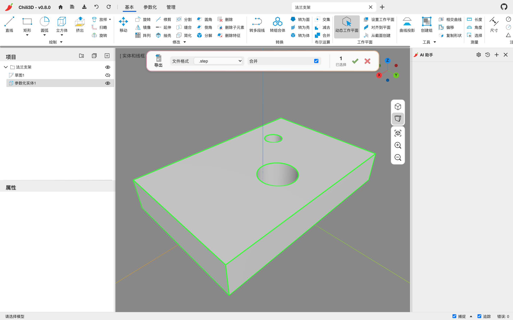

# 8. 文档、文件与撤销

## 8.1 文档与标签

每个文档有独立的视图、项目树、撤销栈和选择状态。标题栏中间是文档标签：

- 点标签切换文档；
- `×` 关闭文档，**每次都会先询问是否保存**；
- 右侧 `+` 新建文档。

同一个浏览器标签页里可以同时打开多个文档，它们共享同一个应用实例。

关闭时出现的是浏览器原生确认框，两个按钮都会继续关闭文档：

- **确定**：先把当前文档保存到 IndexedDB，再关闭；
- **取消**：不保存本次修改，仍然关闭；它不是“返回文档”或“继续编辑”。

这个确认框没有“留在文档”的第三项。修改还没有备份时，先按 `Ctrl+S`，或先执行 `保存到文件`，再点 `×`。如果以前保存过，选择“取消”后重新打开只能回到上次保存的内容。

首页“最近项目”卡片上的 `×` 也不是只移除入口：确认后会**同时删除该文档在 IndexedDB 中的数据和最近项目记录**，没有回收站。删除前请先用 `保存到文件` 做好 `.cd` 备份；已经下载到应用之外的备份文件不受这次删除影响。

## 8.2 保存、版本与备份

| 方式 | 位置 | 说明 |
| --- | --- | --- |
| `保存`（Ctrl+S） | 浏览器 IndexedDB | 存到本地；文档出现在首页“最近项目” |
| `保存到文件` | 下载 `.cd` 文件 | 备份、迁移、分享；`.cd` 是 JSON |
| `打开文档`（Ctrl+O） | 文件选择器 | 读取 `.cd` 文件；也可以从首页“最近项目”打开 |

注意：

- **没有自动保存**。修改后必须手动保存。
- 本手册对应的**应用版本是 0.8.0**，当前**文档格式版本 `documentVersion` 是 0.7.1**，两者是不同编号。打开文档时严格核对文档格式版本：**不同版本必定拒绝加载**，没有迁移机制。
- 打开 `.cd` 会保留其中的文档 ID。之后按 `Ctrl+S` 会用这个 ID 覆盖浏览器中同 ID 的文档和最近项目记录；在应用内重命名文档只改变名称，**不会生成独立副本**。实验性修改前先下载一份 `.cd` 留底，不要靠重命名保护原记录。
- `保存到文件` 不会关闭文档，也不会改变“最近项目”的记录。下载到不同文件名的 `.cd` 可以作为独立文件备份，但在同一浏览器源中打开并保存时，仍按文件内的原文档 ID 写入。

建议重要节点同时保留两类备份，并把下载文件放到浏览器之外的可靠位置：

| 备份 | 适合 | 不包含 |
| --- | --- | --- |
| `.cd` | 在相同文档格式版本中恢复完整文档；按日期保留多个里程碑 | 撤销栈 |
| STEP | 跨应用版本交换最终几何、升级前兜底、交给其他 CAD | 参数化特征树、变量、文档设置、AI 对话和撤销栈 |

升级应用、清理站点数据或删除最近项目之前，先保存 `.cd`；需要跨版本保留几何时再导出 STEP。`.cd` 还会包含已保存的 AI 对话，分享前的处理见 [第 9.6 节](09-ai-assistant.md#96-隐私)。

## 8.3 导入

**基本/参数化 → 导入/导出 → 导入**，选择一个或多个文件：

| 格式 | 说明 |
| --- | --- |
| `.step` / `.stp` | 推荐的中性格式，保留 B-rep |
| `.iges` / `.igs` | 曲面/实体中性格式 |
| `.brep` | OCCT 原生 B-rep |
| `.stl` | 导入为三角面组成的 OCCT 形状 |

导入的模型作为独立节点加入文档，可以被移动、变换、布尔，或作为参数化特征的输入（取决于格式能否提供精确几何）。没有活动文档时会自动新建名为 `Untitled` 的文档；已有活动文档时则加入当前文档。**导入不等于保存**，之后仍需按 `Ctrl+S` 或 `保存到文件`。

STL 只记录三角面，导入后不会恢复原来的光滑 CAD 曲面，也不会还原平面、圆柱面等解析曲面或参数化历史。需要这类精确几何时，优先使用 STEP、IGES 或 BREP。

## 8.4 导出

**导入/导出 → 导出**：



1. 选择要导出的模型（可以多选）。命令面板显示 `文件格式` 和 `合并`。
2. 选格式：

| 格式 | 类型 |
| --- | --- |
| `.step` | B-rep 中性格式 |
| `.iges` | B-rep 中性格式 |
| `.brep` | OCCT 原生 |
| `.stl` / `.stl binary` | 三角网格（ASCII / 二进制） |
| `.ply` / `.ply binary` | 三角网格 |
| `.obj` | 三角网格 |

3. 根据对象数量选择是否 `合并`：

| 选中对象 | `合并` | 下载结果 |
| --- | --- | --- |
| 一个 | 勾选或不勾选 | 一个普通格式文件，不会打包成 ZIP |
| 多个 | 勾选 | 所有对象合并到一个普通格式文件 |
| 多个 | 不勾选 | 每个对象一个文件，再统一打包成 `.zip`，避免连续下载被浏览器拦截 |

普通文件和 ZIP 都按**第一个选中节点的名称**命名；ZIP 内的文件按各自节点命名，重名时追加序号。

导出的是选中节点在**世界坐标**下的最终几何，包括参数化体重建后的形状和节点的变换。

## 8.5 拖放

把文件拖进窗口：

| 文件 | 行为 |
| --- | --- |
| `.cd` | 打开为文档 |
| `.chiliplugin` | 加载插件 |
| `.step/.stp/.iges/.igs/.brep/.stl` | 导入；没有活动文档时自动新建 |

拖放与命令走同一套处理逻辑，导入后同样需要手动保存。

## 8.6 URL 参数

| 参数 | 作用 |
| --- | --- |
| `?url=<文件地址>` | 启动时按扩展名打开一个文档或导入模型 |
| `?model=<文件地址>` | 与 `url` 相同（兼容旧链接） |
| `?plugin=<插件地址>` | 启动时加载插件目录或 `.chiliplugin`；可重复出现多次 |

示例：

```text
https://chili3d.com/?plugin=https://example.com/my-plugin/
https://chili3d.com/?plugin=https://example.com/my-plugin.chiliplugin
https://chili3d.com/?url=https://example.com/part.step
```

`url` / `model` 需要浏览器能直接下载、且文件名以受支持扩展名结尾的直链；跨域地址还必须由服务器正确允许 **CORS**。带有 `?sig=...` 等查询参数的签名 URL 可能使扩展名识别失效，宜改用无查询参数的直链，或先下载文件再手动打开。加载失败时打开浏览器开发者工具的控制台，检查网络状态、CORS 和扩展名相关错误。插件地址的两种形式见 [第 10.4 节](10-settings-plugins.md#104-插件)。

## 8.7 撤销与重做

- **撤销**：Ctrl+Z / 标题栏左箭头。
- **重做**：Ctrl+Y 或 Ctrl+Shift+Z / 标题栏右箭头。
- 每个文档有独立的撤销栈，切换文档不共享，默认最多保留 **50 条**撤销记录，超出后丢弃最旧记录。
- 一次命令 = 一个撤销步骤，包括：
  - 创建一个形状；
  - 修改一个特征参数；
  - 在属性面板改一个字段；
  - AI 的一次 `run_program` / `run_parametric` 调用。
- **保存不会清空当前撤销栈**，保存后仍可在本次会话中撤销、重做。保存后再撤销得到的新状态需要再次保存，才会更新保存的副本。
- 撤销栈本身**不持久化**：关闭文档或刷新页面后，撤销和重做历史都会丢失。撤销后再执行新命令，还会清空当前重做分支。

## 8.8 数据存放位置

- 文档和“最近项目”存在浏览器的 **IndexedDB**；AI 对话属于所在文档的数据，保存文档时一起写入，而不是另有一个自动保存的对话仓库。
- 语言、主题、导航配置等设置存在浏览器本地存储。
- 文档、最近项目和设置都按**浏览器源**隔离。源由协议、域名和端口共同决定，因此官网、镜像、不同端口以及不同浏览器之间不会自动同步。
- AI 的 API Key 只在当前会话内存中，不写入应用的浏览器存储；可以选择交给浏览器密码管理器保管，详见 [第 9.2 节](09-ai-assistant.md#92-配置模型)。
- 换浏览器、换源或清理站点数据，都可能使原位置看不到文档；重要文件请按 [第 8.2 节](#82-保存版本与备份) 使用 `.cd` 和 STEP 备份。

---

下一步：[第 9 章 AI 助手](09-ai-assistant.md)
