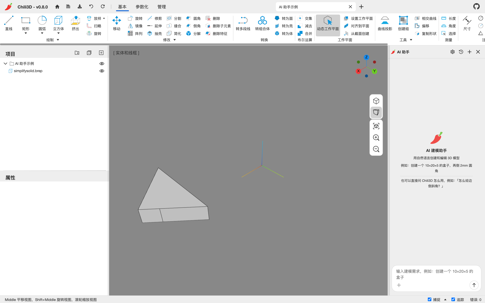
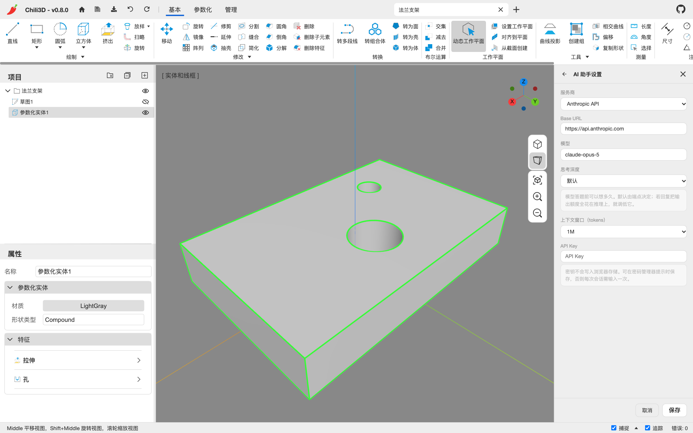
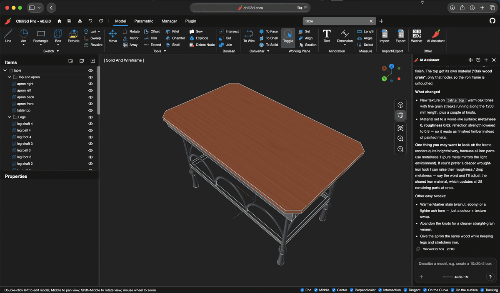

# 9. AI 助手

Chili3D 的 AI 助手不是外挂聊天框：它读写同一个文档、同一份选择、同一棵项目树，做出的修改也进入同一个撤销栈。模型请求由浏览器**直接**发给你配置的 API 端点，不经过 Chili3D 的中转服务器；这不代表数据不出本机，具体发送内容见 [第 9.6 节](#96-隐私)。

## 9.1 打开与布局

- 点 **基本/参数化 → 其他 → AI 助手**，或右侧面板标题栏的图标切换显示。
- 面板默认停靠在右侧；拖动标题栏可以拖出成浮动窗口，浮动窗口标题栏上有“停靠”按钮可以放回去。
- 标题栏按钮：设置（齿轮）、历史对话、新建对话、停靠/关闭。



## 9.2 配置模型

第一次打开（或没有可用的 Key 时）会显示设置页：
设置页也可随时从标题栏齿轮进入。



| 项 | 说明 |
| --- | --- |
| 服务商 | Anthropic API / Completions API（OpenAI 兼容）/ Responses API |
| Base URL | API 根地址；切换服务商会填入预设值，也可自行修改以使用兼容网关 |
| 模型 | 模型 ID，例如 `claude-opus-5`、`gpt-5.5` |
| 思考深度 | 默认 / low / medium / high / xhigh / max；默认表示不发送思考深度字段，由端点决定 |
| 上下文窗口 | 200K / 256K / 400K / 512K / 1M；既用于显示占用，也用于按约 80% 的预算裁剪重发历史 |
| API Key | 只保存在当前会话内存；可选择交给浏览器密码管理器保存 |

说明：

- Base URL 不要自行追加 `/chat/completions` 或 `/responses`，客户端会按所选服务商组织具体请求。比如 OpenAI 官方两种 API 的根地址预设都是 `https://api.openai.com/v1`。
- 远程端点通常需要 **HTTPS**；本地开发地址可按浏览器规则使用 HTTP。端点还需要支持 **CORS、流式响应和工具调用**，并允许来自当前 Chili3D 源的跨域请求。只支持普通文本聊天并不等于兼容建模助手；参考图片和视口截图能否被理解，还取决于所用模型的视觉能力。
- “默认”思考深度**不保证旧网关兼容**：它只是少发送一个可选字段，网关仍须支持该服务商请求使用的其他字段和流式协议。
- Key 不会写入应用的浏览器存储。刷新页面后需要重新输入，除非你选择让浏览器密码管理器保存并填写。
- 如果你的模型把输出额度都花在推理上、正文被截断，调低“思考深度”。

点 `保存` 后进入对话界面。

## 9.3 对话

- 在底部输入框里用自然语言描述需求，`Enter` 发送，`Shift+Enter` 换行。
- 输入框左侧 `+` 可以附加参考图片；也可以直接粘贴图片。
- 发送后按钮变为“停止”，可以中断本轮。
- 助手可能先问你一个澄清问题（例如选择哪个面），直接在输入框回答即可。
- 助手执行工具时，会在消息流里显示“已创建 …”“已删除 …”等操作，部分操作可以点击在视口中定位对象。
- 每条用户消息可以“回退”：把文档和对话都恢复到这条消息之前，并把这条消息放回输入框。适合“这一步不对，重来”。

### 自然语言提示词模板

把目标、约束和验收条件一次写清楚，比只说“做一个法兰”更可靠。可以按下面的模板组织需求，无关项可省略：

```text
对象：【新建什么，或要修改哪个节点；可先选中目标并写明节点名称】
尺寸：【长、宽、高、直径、厚度、圆角等，单位明确写 mm】
位置/基准：【坐标、原点、基准面、参考面/边，以及方向】
操作：【创建、拉伸、开孔、布尔、移动、改属性等】
是否参数化：【保留可继续编辑的特征树 / 直接形状即可】
保留：【哪些现有节点、特征、工具对象或材料不能删除或替换】
验收：【需要核对的尺寸、数量、位置和视图】
如果目标或尺寸有歧义，请先提问，不要自行假设。
```

复杂零件可以分轮完成，例如先核对主体尺寸，再添加孔和圆角；每轮都说明要保留的上一步结果。

### 参考图片

粘贴或上传图片后，助手会先“读图”（核对尺寸、特征），核对完成前不允许执行会改变几何的工具。读图失败时会提示“未能核对参考图——将不依赖它继续”。图片理解能力取决于模型，参考图也不能替代关键尺寸的明确输入。

### 历史与上下文

- 对话写入当前文档的 `document.userData`。点“历史对话”可以切换、删除，新建对话不会删除旧对话。
- 每轮结束会更新内存中的对话，但只有在**保存文档**时才持久化到 IndexedDB；`保存到文件` 也会把对话写入 `.cd`。未保存的新对话和修改会在关闭或刷新后丢失，分享前的隐私处理见 [第 9.6 节](#96-隐私)。
- “上下文窗口”不仅决定占用显示，还决定重发历史预算：估算超过窗口的约 **80%** 时，较早的完整轮次会从发送内容中裁掉，关键意图、操作和失败记录会提炼成简短记录供模型参考。界面中的完整对话仍然保留。
- 裁剪时还可能移除不再需要的旧推理内容和过期视口截图；出现“以上更早的消息已不再发送给模型”时，表示模型看到的上下文已经不同于屏幕上的完整记录。
- 输入区旁的上下文条显示当前占用 / 窗口大小。窗口值应符合端点和模型的实际能力，并不是填得越大越好。

## 9.4 助手能做什么

- **从描述建模**：例如“创建一个 10×20×5 的盒子，再倒 2mm 圆角”。
- **修改现有模型**：改尺寸、加圆角、开孔、布尔、移动、改材质。
- **读取文档**：项目树、几何、当前选择、视口截图，因此“把这个法兰加厚”能定位到正确对象。
- **测量与查询**：长度、面积、体积；面/曲线/曲面类型。
- **组织文档**：建文件夹、移动节点、重命名、设置属性。
- **文档变量**：读取/写入变量表。
- **视图操作**：适应内容、切换视角、截图。
- **导出**：把选中对象导出为文件。



*AI 根据对话完成铁艺桌建模并调整桌面材质；右侧保留本轮修改说明（英文界面）。*

### 两条建模路径

| 路径 | 结果 | 适合 |
| --- | --- | --- |
| `run_program` | 直接建模形状（`EditableShapeNode`），一个调用一个撤销步骤 | 一次性形状、测量、查询、修改 |
| `run_parametric` | 参数化特征树，之后仍可在属性面板继续编辑 | 需要保留设计意图的零件 |

注意：

- `run_program` 的编辑类操作（布尔、圆角、推拉等）会**消耗**输入节点，用返回的新节点继续。
- 不要把参数化实体交给 `run_program` 的编辑类操作——那会破坏特征链。要组合多个参数化体，请让助手用 `run_parametric` 的布尔操作。
- 任何一步失败，整个程序会回滚，不会留下半成品；助手会读错误并修正后重试。
- 单位和角度固定为毫米、度。

### 结果核对清单

不要只凭助手回复“已完成”就保存或交付，至少核对：

- **项目树**：目标节点是否正确，有没有意外删除、消耗或替换输入对象；要求参数化时，特征链是否保留且能继续编辑。
- **关键尺寸**：用测量或几何查询核对长宽、厚度、孔径、数量、位置和体积，单位是否为 mm。
- **空间关系**：适应内容并从多个视角检查基准、方向、对齐、间隙和相交，确认没有多余形体或选错面。
- **保留要求**：原有节点、特征、材料、变量和参考几何是否按提示词保留。
- **最终结果**：撤销或“回退”不正确的轮次后重新生成；核对无误再保存、导出或分享。

## 9.5 没有 API Key 时

不配置 Key 也能使用应用的所有非 AI 功能。AI 面板会保持未配置状态（不显示输入框和示例），直到你在设置里填入 Key。

## 9.6 隐私

请求直接发往你填写的 Base URL，不经过 Chili3D 的中转；使用远程端点时，数据会离开本机到达该端点及其实际模型服务。每轮发送的不只是输入框里的文字：

- **文档与选择摘要**：当前文档名称、节点数量，以及节点的 ID、类型、名称、层级和形状类别；当前选中的节点也会包含在内。
- **对话与参考图**：保留在本轮上下文中的历史消息，以及你粘贴或上传的图片。
- **工具产生的内容**：助手调用工具时，还可能发送几何查询结果、节点属性、材质、文档变量、工具参数与结果，以及视口截图。并非每轮都会发送全部内容，取决于任务和实际工具调用。

使用自建网关或第三方兼容端点时，应按实际接收方评估其日志、留存和隐私策略。“无中转”不等于“完全本地”或“只发送提示词”。

### 对话保存与分享

- 对话属于当前文档的 `document.userData`，保存文档时写入 IndexedDB，执行 `保存到文件` 时也会进入 `.cd`。其中可能包含用户参考图片、工具参数和工具结果；上下文裁剪不会替你删除文档中的完整历史。
- 分享文档前，在“历史对话”中删除相关对话，确认不再含有敏感文字、图片或工具记录，然后再保存文档或重新导出 `.cd`。只新建对话或只让模型忘记旧上下文是不够的。
- 已经下载或分享出去的 `.cd` 不会因之后删除历史而自动更新，需要重新导出并替换。

API Key 只保存在当前会话内存中，不随文档保存，也不进入 `.cd`。你可以选择浏览器密码管理器保管它；此时其存储和同步行为由浏览器及你的密码管理器设置决定。

Microsoft Clarity 是页面中**独立于 AI 请求的统计通道**，与 Base URL 所指的模型服务不是一回事。自托管部署时可以从 Web 入口页移除 Clarity 统计脚本，或在浏览器、网络策略中阻止统计请求；这些设置与 AI 端点配置互不影响。

---

下一步：[第 10 章 设置、插件与快捷键](10-settings-plugins.md)
