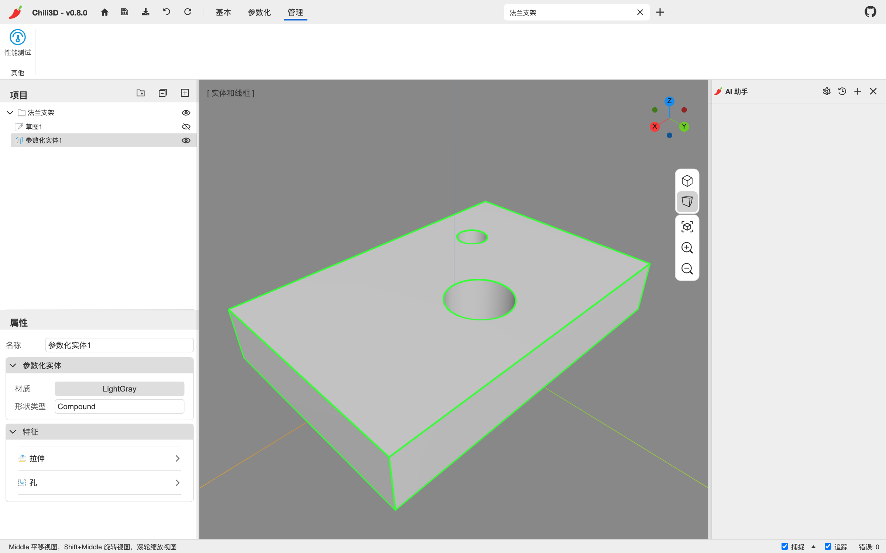

# 10. 设置、插件与扩展

## 10.1 首页设置

首页左侧的设置项会立即生效，并保存在浏览器本地：

| 设置 | 选项 |
| --- | --- |
| 语言 | English / 简体中文 / Português (Brasil) / Русский |
| 主题 | 系统 / 浅色 / 深色 |
| 3D 导航 | Chili3d / Revit / Blender / Creo / Solidworks |
| 环绕方式 | 转盘（锁定 Z 轴） / 轨迹球（自由旋转） |

- **主题**：默认跟随系统；“系统”模式下切换操作系统深浅色，界面和 3D 场景会一起切换。
- **3D 导航**：决定中键/Shift+中键的平移与旋转分配，见 [第 3.1 节](03-view-navigation-selection.md#31-相机导航)。
- **环绕方式**：转盘模式保持 Z 轴向上，适合建筑/机械；轨迹球像转动手中的球，适合自由观察。

单位固定为**毫米**、角度固定为**度**，没有切换项。

## 10.2 界面布局调整

- 拖项目树与属性面板之间的横向分隔条：调整两者高度比例。
- 拖侧栏与视口之间的竖向分隔条：调整侧栏宽度。
- 拖 AI 面板左侧的分隔条：调整 AI 面板宽度。
- 文档标签和功能区标签会自动适应窗口宽度；功能区放不下时可横向滚动。

## 10.3 快捷键

完整列表见 [附录 B](appendix-shortcuts.md)。最常用的：

| 快捷键 | 命令 |
| --- | --- |
| Ctrl+S / Ctrl+O | 保存 / 打开 |
| Ctrl+Z / Ctrl+Y | 撤销 / 重做 |
| Delete / Backspace | 删除选中节点 |
| Space / Enter | 重复上一个命令 |
| L / R / C | 直线 / 矩形 / 圆 |
| B / S / Y / N | 立方体 / 球体 / 圆柱 / 圆锥 |
| P / Q | 挤出 / 推拉 |
| M / Shift+R / Shift+A | 移动 / 旋转 / 阵列 |
| Shift+F / Shift+C | 圆角 / 倒角 |
| T / O | 修剪 / 偏移 |
| D | 测量长度 |
| X / Shift+I | 分解 / 交集 |

`Space`/`Enter` 在文本输入区之外且**不处于拾取状态**时重复上一个命令，与当前有没有选中对象无关；命令正在拾取时，它们用于确认当前拾取。

macOS 的全局 Ctrl 快捷键也接受 `Cmd`，例如 `Cmd+S`、`Cmd+Z`。但项目树的多选仍是 **Ctrl+单击**，不能用 Cmd 替代；Shift+单击用于范围选择。

## 10.4 插件

### 加载插件

三种方式：

1. URL 参数（可重复）。远程地址有两种有效形式：

   ```text
   http://localhost:8080/?plugin=https://example.com/my-plugin/
   http://localhost:8080/?plugin=https://example.com/my-plugin.chiliplugin
   ```

   - 目录地址：目录中必须有 `manifest.json`，由清单声明入口 JS、CSS 和资源；
   - `.chiliplugin` 地址：直接指向完整插件包。

   不能把任意 `extension.js` 之类的单个脚本地址当作插件 URL。

2. 把 `.chiliplugin` 文件拖进窗口。
3. 在页面里通过插件管理接口加载（`app.pluginManager.loadFromUrl`），同样使用上面的目录或包地址。

### 信任、安全与跨域

插件入口是可执行的 JavaScript，并能调用应用接口、注册命令和服务、读取或修改文档；它不是只能添加按钮的受限模板。**只加载你信任作者和来源的插件**，来源不明时不要点“信任”，最好先审查代码和清单。

- 远程插件来自陌生域名时，会先弹出“是否信任来自以下域名的脚本？”的确认，选择信任后才加载。这个确认不是安全扫描，信任的是来源域名。
- 本地拖入 `.chiliplugin` **不会经过陌生域名确认**。没有提示不代表安全，本地包同样只应来自可信来源。
- 远程加载清单、插件包、入口脚本和其他资源时，服务器必须正确允许 **CORS**。加载失败时检查地址形式、清单、网络响应和浏览器控制台中的跨域错误。

### 插件能做什么

插件可以注册：

- 新命令（`Command`）；
- 新功能区标签/组/按钮；
- 新的 i18n 文案；
- 面板、工具、事件处理等。

加载后的插件通常会在功能区新增一个 **插件** 标签。

### 仓库自带示例

| 示例 | 内容 |
| --- | --- |
| HelloWorld（JavaScript / TypeScript） | 最小插件：一个命令 + 一个功能区按钮 + 中英文文案 |
| 宏管理器 | 新建/编辑/运行/删除 JavaScript 宏。插件标签中出现“宏” |
| 可视化编程 | 基于 Rete.js 的节点式编辑器（Grasshopper 风格）。插件标签中出现“可视化编程” |

这些示例位于仓库的插件工作区。以宏管理器为例，在它的项目目录中构建与打包：

```bash
npm run build      # 构建
npm run package    # 生成 .chiliplugin
```

`.chiliplugin` 是一个包含 `manifest.json`、入口 JS/CSS 和资源的包；把它拖进 Chili3D 即可加载。拖包不会写入一个永久“已安装插件”列表，刷新后需要重新拖入，或改用 `?plugin=` 启动参数。信任某个域名会保存该信任设置，但也不会自动加载这个域名的插件。

## 10.5 性能测试

**管理** 标签里的 `性能测试` 会：

1. 新建一个名为 `OCC Performace Test` 的文档；
2. 生成 20×20×20 = 8000 个随机尺寸的盒子；
3. 弹窗报告总耗时。

它用于粗略比较机器/浏览器的内核与渲染性能，会占用大量内存，建议只在新会话里运行。



## 10.6 浏览器要求与数据

- 需要支持 **WebAssembly** 和 **WebGL 2** 的现代浏览器（Chrome/Edge/Firefox/Safari 的较新版本）。
- 文档与最近项目保存在浏览器 **IndexedDB**；清理站点数据会丢失它们，重要文档先按 [第 8.2 节](08-document-files.md#82-保存版本与备份) 备份。
- 主题、语言、导航、环绕方式，以及不含 Key 的 AI 配置保存在本地存储；AI 对话随所在文档保存。
- 文档、最近项目和设置按浏览器源（协议、域名、端口）隔离。官网、镜像、不同端口或不同浏览器之间不会自动同步，迁移文档要使用 `.cd`，设置则需分别配置。
- AI API Key 只存在于当前会话内存；可选择使用浏览器密码管理器保管，隐私说明见 [第 9.6 节](09-ai-assistant.md#96-隐私)。
- 应用使用 Microsoft Clarity 统计，它是独立于 AI 请求的统计通道。自托管时可从 Web 入口页移除统计脚本，或通过浏览器、网络策略阻止统计请求。

## 10.7 从哪里获取帮助

- 首页右侧的“社区视频”有更新记录和案例展示。
- GitHub：<https://github.com/xiangechen/chili3d>（Issues / Discussions）。
- 微信群二维码在功能区的“其他”组。
- B 站有中文视频教程（见项目 README）。

---

下一步：[第 11 章 常见问题](11-faq.md)，或回到 [手册目录](README.md)。
