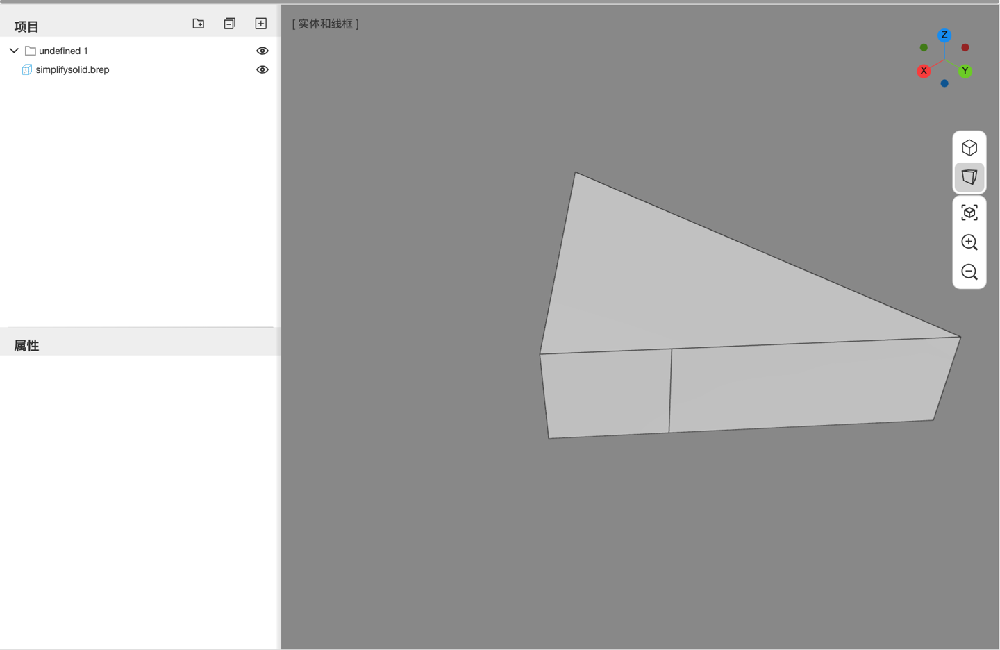

# 12. 典型工作流程

前面的章节按界面和命令组织。这一章改为按任务组织，把常用命令串成完整流程。示例尺寸均为毫米、角度均为度；第一次练习时，建议使用新文档并先保存一次。

## 12.1 参数化安装板：从变量到交付

目标：做一块 **120 × 80 × 8** 的安装板，四角各有一个 M8 普通间隙通孔，孔中心距相邻两边 15，四条竖直外边的圆角半径为 3。最后把板宽改成 140，检查孔位和圆角是否能随特征链更新。

### 第一步：建立变量

1. 新建文档；如果自动弹出“AI 助手设置”，先点 `取消`。在项目树选中根节点，于属性面板把文档命名为 `参数化安装板`，再按 `Ctrl+S` 保存。
2. 打开 **参数化 → 其他 → 变量**。
3. 在表格底部的空白“名称”行输入变量名，按 `Enter` 建立变量，再设置类型和值：

| 名称 | 类型 | 值 | 用途 |
| --- | --- | --- | --- |
| `plateWidth` | 长度 | `120` | 板在 X 方向的总宽 |
| `plateDepth` | 长度 | `80` | 板在 Y 方向的总深 |
| `plateThickness` | 长度 | `8` | 拉伸厚度 |
| `holeInset` | 长度 | `15` | 孔中心到相邻两边的距离 |

变量只能引用位于它上面的变量。每次修改都会在失焦或按 `Enter` 时提交；关闭变量面板不会撤销修改。

### 第二步：画并完全约束草图

1. 点 **参数化 → 新建草图**，选择蓝色 XY 基准面。
2. 用 `矩形` 任意画一个矩形。矩形工具已经生成闭合、水平和竖直约束，不要重复添加。
3. 用 `重合` 把左下角与草图原点约束在一起；也可以用 `固定` 固定左下角，再双击固定约束徽标，把坐标设为 `0, 0`。
4. 用 `尺寸` 标注一条水平边，输入 `plateWidth`；标注一条竖直边，输入 `plateDepth`。
5. 用 `点` 在矩形内部放置四个独立点。这些点不是线段端点，也不是圆心，之后可由孔特征直接引用。
6. 对每个点分别添加相对矩形左下角的 `水平距离` 和 `竖直距离`，使用下表的表达式：

| 点 | 水平距离 | 竖直距离 |
| --- | --- | --- |
| 左下孔 | `holeInset` | `holeInset` |
| 右下孔 | `plateWidth - holeInset` | `holeInset` |
| 左上孔 | `holeInset` | `plateDepth - holeInset` |
| 右上孔 | `plateWidth - holeInset` | `plateDepth - holeInset` |

7. 查看状态栏：目标不是“看起来差不多”，而是显示 **完全约束**。如果仍有余下自由度，寻找蓝色图元并检查漏标的尺寸；如果冲突，先处理约束，不要继续拉伸。

这里的矩形闭合轮廓用于拉伸，四个独立点只用于定位孔，不会变成额外的拉伸轮廓。详细操作见 [第 7 章](07-sketch.md)。

### 第三步：拉伸板体

1. 退出草图，在项目树选中草图，点 **参数化 → 拉伸**。
2. `操作` 选择 `新建`，`终止条件` 选择 `给定深度`，`深度` 输入 `plateThickness`。
3. 确认预览只有一块板，没有四个点产生的额外几何，再提交特征。
4. 选中生成的参数化体，展开属性面板的特征列表，确认第一项是拉伸。

如果需要在轮廓平面两侧拉伸，注意 `对称` 是两侧各使用完整的“深度”，不是把深度平分成两半。

### 第四步：用草图点创建标准孔

1. 在项目树中重新显示刚才的草图，启动 **参数化 → 孔**。必要时转动视图，避开实体遮挡。
2. 按状态栏提示，依次单击四个独立点的十字标记；命令内单击会切换点的选中状态，不需要按住 `Shift`。四个点必须来自同一张草图。
3. 在命令面板把 `类型` 设为 `简单`，创建时的 `深度` 留空表示贯通。
4. 按 `Enter`/`Space` 或确认条结束点拾取。应用会尝试根据草图找到共面的钻孔面；如果提示找不到，再单击板的底面或顶面，已选的点会保留。检查预览，并按提示再次确认，完成孔命令。
5. 展开新建的孔特征，在 `预设` 中选择 `M8 · normal · ⌀9`。预设会把普通间隙孔径 9 写入参数；之后仍可独立修改数值。
6. 检查四个孔都贯穿板体，并随四个草图点定位。

预设用于螺钉通过和头部让位，不会创建螺纹，也不是攻丝底孔表。需要沉台或锥形沉口时，改用 `沉孔` 或 `锥沉孔`，再选择对应预设。完整参数见 [第 6 章](06-parametric-modeling.md)。

### 第五步：添加圆角并修改上游尺寸

1. 点 **参数化 → 圆角**，选择四条竖直外边，设置 `半径 = 3` 并确认。不要选择孔口边。
2. 打开变量表，把 `plateWidth` 从 `120` 改为 `140`。
3. 等待重建完成后检查：
   - 板的总宽变为 140，深度和厚度不变；
   - 左侧孔仍距左边 15，右侧孔仍距右边 15；
   - 四个孔和四处圆角仍存在，特征行没有错误或缺失输入。
4. 用 **基本 → 测量 → 长度** 测量同一排左右两个孔的中心距，应为 `plateWidth - 2 * holeInset = 110`。再用 `测量 → 选择` 记录体积，供交付时复核。

如果修改后报错，视口里可能仍是上一次成功的形状，这并不表示新参数已经生效。先撤销刚才的变量编辑，再从第一个错误特征开始排查；不要一看到旧模型就继续导出。

### 第六步：保存与导出

1. `Ctrl+S` 保存可继续编辑的文档。
2. 再用 `保存到文件` 下载 `.cd` 作为独立备份。
3. 选中参数化体，执行 **导入/导出 → 导出**，选择 STEP；需要与其他 CAD 交换时优先使用 STEP，而不是 STL。
4. 重新打开导出的文件或导入到另一个新文档，检查尺寸、孔和圆角。导出成功不等于接收方一定能正确读取，交付前应在目标软件中再检查一次。

## 12.2 导入模型：检查、修补与重新导出

直接建模适合处理没有特征历史的导入几何。开始前先保留原文件，不要只依赖撤销。



*BREP 导入后，文件名出现在项目树中；接下来可检查、测量或修补几何。*

### 选择合适的格式

| 输入 | 推荐路径 | 注意事项 |
| --- | --- | --- |
| STEP / IGES / BREP | 导入后直接检查精确几何 | 适合测量、布尔和局部修形；IGES 仍需检查曲面缝合情况 |
| STL | 导入后按三角面模型处理 | 不会恢复原始光滑 CAD 曲面，不适合期待与 STEP 相同的精确编辑能力 |
| `.cd` | 打开整个 Chili3D 文档 | 严格匹配文档格式版本，不是中性格式 |

### 操作流程

1. **导入**：执行 **基本 → 导入/导出 → 导入**。有活动文档时，模型加入当前文档且尚未自动保存；没有活动文档时会新建 `Untitled` 文档。
2. **定位**：清除选择后执行 `适应内容`，再切到 `实体和线框` 检查边和开口。
3. **检查**：选中导入节点，执行 `检查形状`，记录无效面或拓扑问题。
4. **修复**：先对副本或已备份的文档执行 `修复形状`，然后再次检查。不要用“能显示”代替“几何有效”。
5. **按需修改**：
   - 多余的小凸台、圆角等，可尝试 `删除特征` 或 `删除子元素`；
   - 多个分离面需要组成壳时，使用 `缝合` 并检查容差；
   - 需要布尔时，先明确目标与工具，并决定是否勾选 `保留操作对象`；
   - 只需移除重复分割线时，尝试 `简化`，再比较修改前后的几何。
6. **测量**：抽查关键长度、面积和体积。网格或经过修复的模型尤其需要确认尺寸没有因单位或缩放理解错误而偏离。
7. **保存中间结果**：重要修改前后分别执行 `保存到文件`，保留可回退的 `.cd`。
8. **导出**：精确 CAD 交付优先 STEP/BREP；3D 打印或网格流程再选 STL/OBJ/PLY，并确认接收方要求的单位和格式。

每一步修形都可能替换原节点。发现结果不对时立即 `Ctrl+Z`，不要在一串错误结果上继续修补。详见 [第 4 章](04-direct-modeling.md) 和 [第 5 章](05-modify-convert-measure.md)。

## 12.3 AI 协作：把需求写清，把结果查清

AI 可以减少重复操作，但不能代替几何检查。给它的需求越接近一份小型设计说明，结果越容易验证。

### 提示词结构

尽量包含以下信息：

- **对象**：新建零件，或当前选中的哪个节点；
- **尺寸与单位**：长、宽、高、直径、半径、角度，明确使用毫米/度；
- **位置与基准**：相对原点、某个面、某条边或已有孔中心；
- **建模方式**：要求保留参数化特征，还是允许直接建模；
- **保留条件**：哪些面、孔、圆角、节点或材质不能改变；
- **完成标准**：希望检查哪些尺寸、特征或测量值。

例如：

```text
请用参数化特征新建一块 120 × 80 × 8 mm 的安装板。
草图放在 XY 平面，板宽沿 X、板深沿 Y，厚度沿 +Z。
建立 plateWidth、plateDepth、plateThickness 三个长度变量驱动尺寸。
先只做草图和拉伸，不要加孔或圆角；完成后告诉我特征列表和实际尺寸。
```

确认第一步正确后，再发送：

```text
继续使用同一个参数化体，不要替换成直接建模节点。
在距四条边均为 15 mm 的位置增加四个直径 9 mm 的通孔，再测量板的长、宽、高。
如果无法保持参数化引用，请先说明，不要删除重建整个零件。
```

### 每轮之后的检查

1. 看项目树：是在原参数化体上增加特征，还是意外生成了独立形状。
2. 看特征列表：操作、尺寸和引用是否符合要求，是否有警告或缺失输入。
3. 看视口：方向、内外环、孔的位置、圆角对象是否正确。
4. 做测量：至少抽查一个总体尺寸和一个局部尺寸，不只看文字回复。
5. 试改上游：需要参数化时，修改一个变量，确认下游确实联动。

不满意时，可以用该条用户消息的 `回退` 同时恢复文档和对话，也可以用 `Ctrl+Z` 撤销对应建模调用。连续多次调用可能对应多个撤销步骤。

### 分享前检查隐私

文档节点摘要、选择、工具查询结果、视口截图和参考图片可能发送给配置的模型端点。对话会随文档保存，也可能包含在 `.cd` 中。分享文件前，删除不需要的历史对话，再执行 `保存` 和 `保存到文件`，确保导出的文档也已更新；不要把“无 Chili3D 中转”理解成数据没有离开本机。详见 [第 9 章](09-ai-assistant.md)。

## 12.4 交付前检查清单

### 几何与参数

- [ ] 视口中没有依赖“上一次成功形状”掩盖的特征错误。
- [ ] 草图按设计需要完全约束，没有未处理的冲突或冗余。
- [ ] 关键尺寸、面积或体积已抽查，单位明确为毫米。
- [ ] `检查形状` 未报告需要继续处理的问题。
- [ ] 孔、螺纹、沉孔等制造信息没有被几何外观混淆；孔预设不等于真实螺纹。
- [ ] 实例需要独立修改时已执行 `使独立`，没有意外联动。

### 文件与数据

- [ ] 已执行 `保存`，并用 `保存到文件` 留下 `.cd` 备份。
- [ ] 精确几何另存 STEP/BREP；网格格式只用于适合的工作流。
- [ ] 知道接收方的 Chili3D 文档格式版本，或改用中性格式避免版本限制。
- [ ] 没有把同一文档 ID 的备份当成“另存为”独立副本反复覆盖。
- [ ] 分享 `.cd` 前已检查 AI 对话、参考图片和其他文档数据。
- [ ] 插件来自可信来源；重要文档没有交给不明脚本处理。

---

上一章：[第 11 章 常见问题](11-faq.md) · 下一步：[第 13 章 Pro 直接编辑](13-pro-direct-editing.md) · 回到 [手册目录](README.md) · 查 [附录 C 术语表](appendix-glossary.md)
