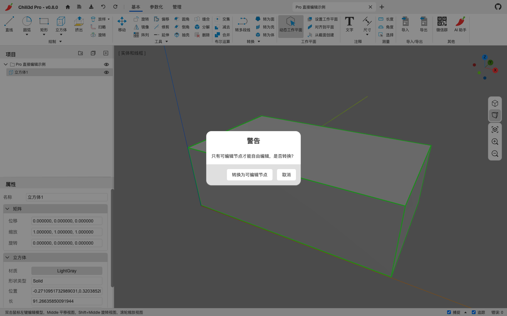
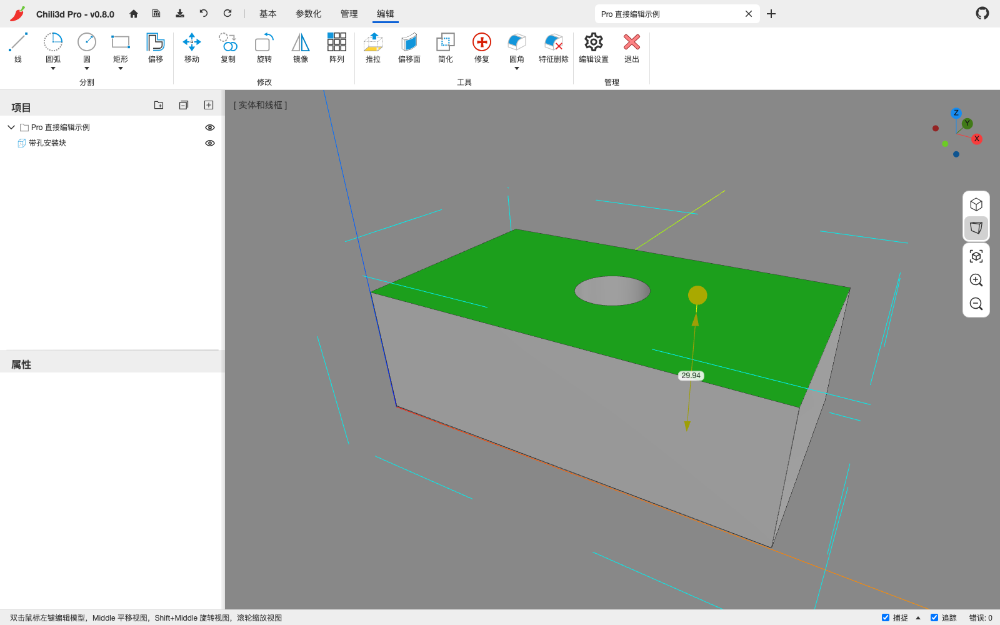
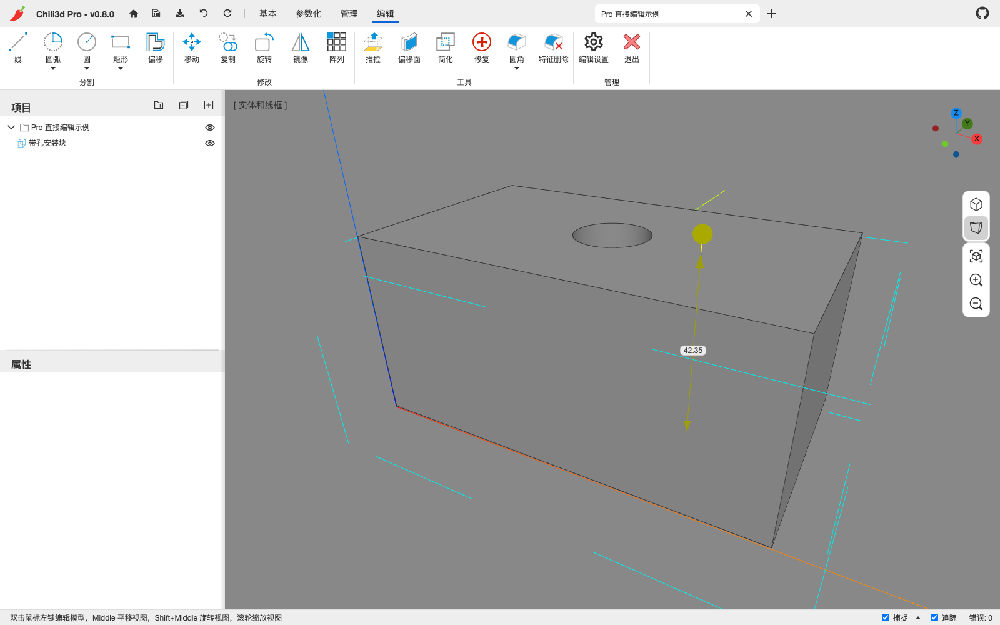
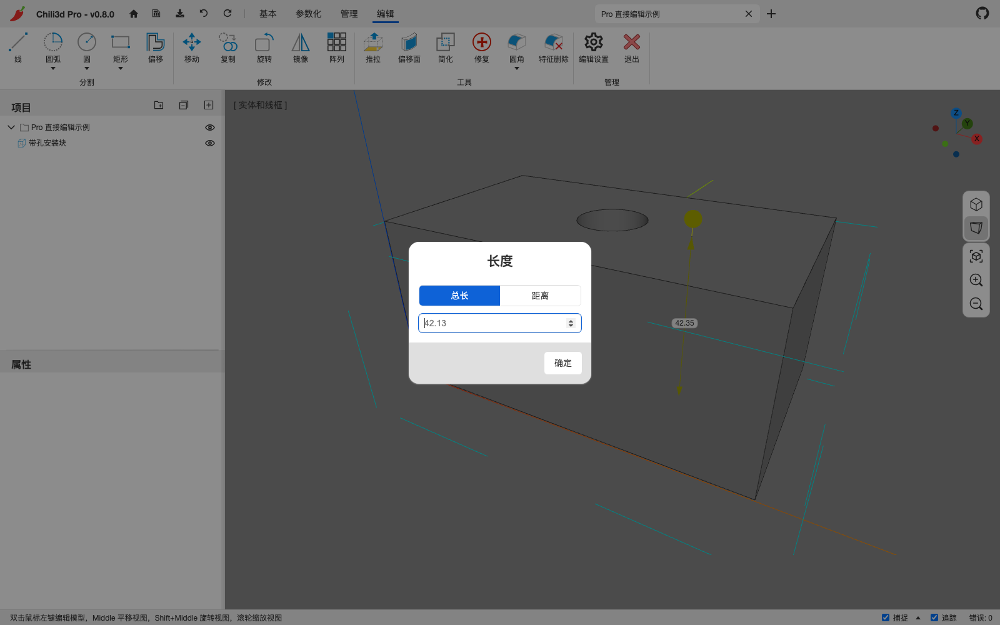
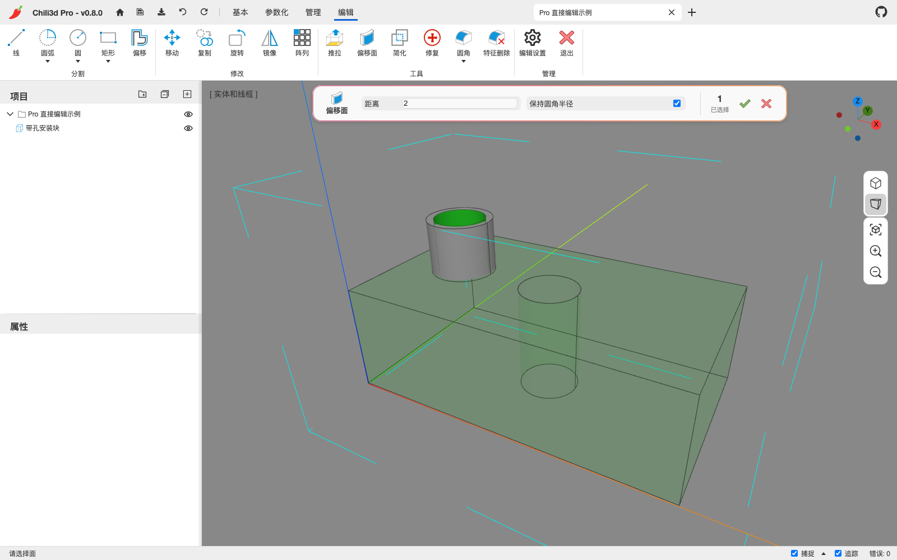
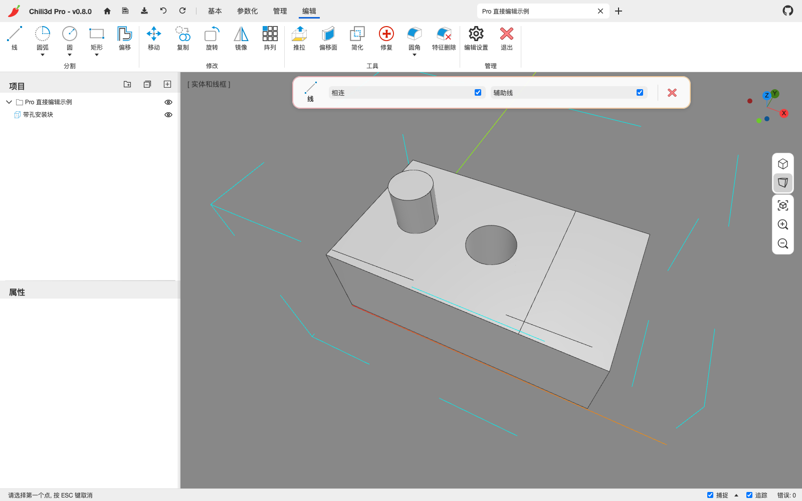

# 13. Pro 直接编辑

> 本章仅适用于 **Chili3D Pro**。社区版没有这里的双击编辑会话和上下文 **编辑** 标签；社区版的直接建模与修改命令见 [第 4 章](04-direct-modeling.md) 和 [第 5 章](05-modify-convert-measure.md)。

Pro 的**直接编辑**用于修改已经存在的 B-rep 几何：双击模型后，直接选择顶点、边或面，通过拖拽、推拉、偏移、分割、圆角、倒角、移动和修复等操作改变当前节点。它不需要原模型带有参数化特征树，因此也适合处理导入模型。

## 13.1 先分清三种操作方式

| 方式 | 主要入口 | 修改对象 | 是否保留特征历史 |
| --- | --- | --- | --- |
| 直接建模 | **基本** 标签 | 创建或替换形状节点 | 不保留完整历史；部分节点可改公开参数 |
| 参数化建模 | **参数化** 标签、草图 | 参数化体及其特征链 | 保留，可编辑特征并联动重建 |
| Pro 直接编辑 | 双击模型后的 **编辑** 标签 | 可编辑节点中的边、面等子形状 | 不新增参数化特征历史，以撤销和备份回退 |

如果后续仍需通过变量、草图尺寸和特征链驱动模型，应优先留在参数化工作流中。直接编辑适合快速修形、无历史模型和需要手动拾取的局部修改。

**开始前先保存。** 建议用 `Ctrl+S` 保存当前文档，并在重要修改前用 `保存到文件` 留下 `.cd` 备份。直接编辑不会自动保存；退出编辑模式也不会保存文档。

## 13.2 进入、转换与退出

### 双击进入编辑模式

1. 在视口中找到要修改的形状。
2. 用鼠标左键快速双击该形状。
3. 已是可编辑节点的模型直接进入编辑；其他形状节点会弹出 `转换为可编辑节点` 的提示。
4. 进入后，功能区自动打开 **编辑** 标签，模型周围出现青色虚线编辑边界。

编辑模式只针对当前节点。不要通过双击项目树文字进入；入口是视口中的模型形状。

### 转换为可编辑节点前必须确认的影响

参数化体或其他尚未可直接编辑的形状节点，需要先转换。点击 `转换为可编辑节点` 后：

- 当前几何、名称、变换和材质会保留；
- **原参数化特征列表及其可编辑历史会丢失**，结果成为保存当前 B-rep 的可编辑节点；
- 之后的直接编辑不会重新生成这棵树，也不能在属性面板恢复原特征参数；
- 误转换时立即 `Ctrl+Z`。已经继续做了其他操作时，可能需要逐步撤销，或重新打开转换前的备份。

*不可直接编辑的节点会先显示转换提示；确认前应评估特征历史和实例影响。*

如果只是要修改拉伸深度、孔径等已有特征参数，应点 `取消`，改用 [第 6 章](06-parametric-modeling.md) 的参数化编辑，不要为了改一个尺寸而转换整个参数化体。

### 双击实例会编辑源节点

双击实例时，Pro 会转到它的**源节点**。对源节点的转换和后续几何修改会反映到共享该源的所有实例，而不是只改当前副本。

只改一个实例时，先退出编辑，选中该实例并执行 `使独立`，再双击编辑。实例关系见 [第 5.1 节](05-modify-convert-measure.md#51-变换移动旋转镜像阵列)。

### 退出编辑模式

以下任一方式都可以退出：

- 点 **编辑 → 管理 → 退出**；
- 没有运行命令时按 `Esc`；如果正在拾取或执行命令，先按 `Esc` 取消当前命令；
- 单击编辑边界以外的区域。

退出后会解除本次编辑对其他对象的隐藏或锁定，恢复普通选择，并关闭 **编辑** 标签。**退出不等于撤销，也不等于保存。** 已提交的修改仍留在文档中，需要 `Ctrl+S` 保存。

## 13.3 选择、隔离与编辑设置

### 子形状选择

| 操作 | 结果 |
| --- | --- |
| 单击顶点、边或面 | 选中当前节点内的子形状 |
| `Shift+单击` | 加选或减选子形状 |
| `Enter` / `Space` | 在命令中确认当前拾取 |
| `Esc` | 先取消当前命令或拾取；未运行命令时退出编辑 |
| `Delete` / `Backspace` | 删除选中的边、面或辅助线并重建当前节点 |

普通模式单击形状是选择整个节点；编辑模式单击是选择节点内部的子形状。命令会继续过滤输入，例如圆角只接受边，偏移面只接受面。多选移动时，边和面不能混选，命令会保留与首个选中对象相同的类型。

*进入编辑后自动打开“编辑”标签；绿色面为当前选择，黄色圆形手柄用于拖拽，青色虚线框标出编辑边界。*

### 隔离模式

打开 **编辑 → 管理 → 编辑设置**，在 `隔离模式` 中选择：

| 模式 | 编辑时的效果 |
| --- | --- |
| `锁定`（默认） | 其他对象仍可见，但不能作为普通编辑对象选中；适合观察装配关系 |
| `隐藏` | 只显示正在编辑的节点；适合检查内部或避免遮挡 |

无论哪种模式，编辑命令都只修改当前节点。切换模式立即生效；退出编辑后解除本次隔离，并恢复普通选择。该设置保存在浏览器本地，下次编辑会继续使用。

需要移动整个节点或编辑另一个零件时，先退出直接编辑，再使用普通节点选择或 **基本** 标签的命令。

### 拖拽编辑圆角开关

`编辑设置` 中的 `拖拽编辑圆角` 默认关闭。开启后，可拖动识别出的现有圆角面来调整半径，见 [第 13.4 节](#134-拖拽编辑)。该开关同样会保存在浏览器本地。

### 删除子形状与删除节点不同

编辑模式中的 `Delete` / `Backspace` 作用于当前选择的子形状：

- 删除面会使原来的封闭壳出现开口，**不会自动用新面堵住洞口**；
- 删除边会经过简化和重建，结果取决于周围拓扑；
- 选中辅助线时，只删除辅助线，不切掉实体几何；
- 要干净地移除圆角、凸台等局部特征，优先尝试 `特征删除`，不要直接删除它的所有面。

误删后立即 `Ctrl+Z`。`修复` 可以缝合和修复现有几何，但不能凭空恢复一张已经删除的面。

## 13.4 拖拽编辑

选中可处理的边或面后，附近会出现黄色圆形拖拽手柄。按住手柄并移动鼠标，视口显示几何预览和数值；松开后，根据操作吸附情况提交，或弹出数值输入框供精确输入。结果不符时先撤销，再重新选择。

### 平面拖拽：偏移或推拉

1. 单击一个平面；需要一起移动时，用 `Shift+单击` 选择法线平行的多个平面。
2. 拖动黄色手柄，沿面的法线向外或向内移动。
3. 查看预览。Pro 优先按**偏移面**处理，让相邻面和可保留的圆角跟随；当前选择或几何不适合偏移时，会退回**推拉**方式。
4. 松开后输入最终数值并确认，或使用下述面吸附结果。

*拖动平面手柄时，视口实时显示新形状和距离；松开后再确认精确数值。*

拖动时可把光标移到与拖动方向平行的目标面上，将移动面吸附到该面的位置。目标可以来自其他可见模型；它被用作位置参考，不会被修改。

检测到相对面时，数值对话框可能提供：

- `总长`：移动后，相对面与当前面之间的总距离；
- `距离`：本次从原位置开始移动的增量。

先确认当前显示的是哪种数值，再输入。没有相对面时，数值就是本次拖动距离。若提示无法保持圆角半径并已改用推拉，应重新检查圆角和相邻面，不要只看移动面的终点。

*存在相对面时，可在“总长”和“距离”之间切换；两种数值的含义不同。*

### 边拖拽：圆角或倒角

1. 选择一条边，或用 `Shift+单击` 选择多条可处理边。
2. 拖动黄色手柄。拖动方向决定生成圆角还是倒角，预览会显示对应结果。
3. 松开后，在 `半径` 或 `长度` 对话框中输入精确值并确认。

只有连接两个非平行面的边才提供这种手柄。自由边、相邻面互相平行的边或无法计算的拓扑不会出现手柄。拖拽会限制在几何允许的范围附近，但复杂边仍可能构建失败；失败时减小半径或长度、减少同时选择的边，或改用命令面板重试。

### 拖动现有圆角面改半径

1. 在 **编辑设置** 中开启 `拖拽编辑圆角`。
2. 选择识别出的非平面圆角面。
3. 拖动手柄调整半径，松开后确认数值。

只有能识别并移除、再重建的圆角面支持此操作。普通圆柱面或其他曲面不一定会出现手柄；需要改变孔壁或圆柱侧面的半径时，使用 `偏移面`。

## 13.5 工具：推拉、偏移面、圆角与倒角

### 推拉

**编辑 → 工具 → 推拉** 用两次拾取完成一个平面的推拉：

1. 选择一个平面。
2. 沿该面的法线拾取目标点，观察预览。
3. 在拾取目标点时按 `Alt`，可切换 `新面` 模式：开启时保留推拉形成的分面，关闭时尝试简化共面边和面。该模式没有独立复选框，切换后以预览中的分面和边线为准。
4. 确认结果；需要精确尺寸时使用点捕捉或数值输入。

推拉只接受具有明确平面的面。要改变圆柱侧面的半径，或希望相邻圆角尽量保持原半径，应改用 `偏移面`。

### 偏移面

**编辑 → 工具 → 偏移面** 可移动平面或曲面，适合调整板厚、外形以及孔和圆柱的半径：

1. 选择一个或多个面，按 `Enter` / `Space` 或确认按钮结束拾取。
2. 在命令面板设置 `距离`。正值沿面的外法线移动，负值反向移动；不能输入 `0`。
3. 按需设置 `保持圆角半径`（默认开启）。开启时，移动面旁边的圆角会尽量拆除后按原半径重建；无法保持时，命令会拒绝提交，而不是静默改成其他半径。
4. 检查半透明原几何上的结果预览，再确认。

*选择圆柱侧面并设置距离后，原几何半透明显示，可直观检查偏移结果和“保持圆角半径”选项。*

对孔壁而言，实体面的外法线通常朝向孔内，因此**正距离通常使孔变小，负距离通常使孔变大**。不同拓扑仍应以预览和最终测量为准。

常见提示的处理：

| 提示或现象 | 处理方法 |
| --- | --- |
| 距离超出可偏移范围 | 减小距离，或分多次小距离修改 |
| 这些面无法偏移 | 换选面，先 `简化`，或改用 `推拉` |
| 需要实体 | 当前对象不是可偏移的实体；改用适合面/壳的命令 |
| 存在封闭内部空腔 | 当前偏移流程不支持，改用其他建模路径 |
| 无法保持圆角半径 | 减小距离、调整选面，或先移除再重建圆角 |

失败时不要反复提交同一组输入。先撤销已确认的错误结果，再检查模型是否仍然封闭、选面是否正确。

### 圆角 / 倒角

1. 点 **编辑 → 工具 → 圆角**，或展开该拆分按钮选择 `倒角`。
2. 选择一条或多条边，结束拾取。
3. 分别输入 `半径` 或 `长度`，检查预览后确认。

这些命令只处理当前编辑节点，结果直接替换当前几何，不生成可继续编辑的参数化圆角/倒角特征。需要保留半径参数和上游联动时，应取消编辑转换并使用参数化命令。

## 13.6 分割：在现有模型上绘制

**编辑 → 分割** 中的工具不是新建独立草图节点，而是把绘制的几何用于当前节点的分割。一般流程为：选择工具 → 在面或工作平面上拾取 → 检查分割结果。

| 工具 | 拾取步骤 / 选项 |
| --- | --- |
| 线 | 起点 → 终点；可连续绘制，`Enter` 或 `Esc` 结束 |
| 圆弧 | 圆心 → 起点/半径点 → 决定扫掠角的点 |
| 2点圆弧 | 起点 → 终点 → 弧高点 |
| 3点圆弧 | 起点 → 弧上一点 → 终点 |
| 相切相切半径圆弧 | 两条参考边 → 决定半径的点或数值 |
| 圆 | 圆心 → 半径点 |
| 椭圆 | 中心 → 长轴端点 → 短轴端点 |
| 矩形 | 第一角点 → 对角点；`中心矩形` 改为中心 → 角点 |
| 多边形 | 中心 → 半径点；在命令面板设置边数 |
| 偏移 | 选择一个面 → 拾取偏移距离；使用面的**外环**，可设置连接类型 |

绘制时可使用端点、中点、圆心、交点、在面上等捕捉。先让首个拾取点落在目标平面上，或先设置好工作平面，再检查预览，避免把分割线画到错误方向。

### 分割会保留可继续使用的线

线、圆弧和闭合轮廓会与当前形状求交并分割面。绘制工具还会保留落在原形状外的线段作为自由边；这些边与已有边界组成合适的共面闭合环时，可以形成新面。因此可以像在平面上作画一样，逐步分割、补面，再推拉某个区域。

如果只要局部凸台，先画完整闭合轮廓，再选择轮廓内的面进行推拉。分割失败时当前节点保持原样；不要假定预览已经提交，应以命令结束后的模型为准。

### 辅助线

除 `偏移` 外，上述绘制分割工具提供 `辅助线` 复选框：

- **不勾选（默认）**：绘制内容参与实际分割；
- **勾选**：绘制内容保存为虚线辅助边，不切割实体，但仍可捕捉和选中。

辅助线只在编辑该节点时显示，退出后隐藏但不会删除，并随节点和文档保存。要删除辅助线，重新进入编辑，选中虚线后按 `Delete` / `Backspace`。辅助线适合保留定位线、对齐参考和后续分割所需的构造几何。

*前方长虚线为辅助参考，右侧实线轮廓为实际分割；勾选“辅助线”后，绘制内容不会切割实体。*

## 13.7 修改：移动、复制、旋转、镜像与阵列

这一组命令直接处理当前节点的子形状，不等同于 **基本** 标签对整个节点的变换。

### 移动

`移动` 会移动选中的面或边，并重建受影响的相邻面：

1. 预先选择同类型的多个面或多条边，或启动命令后按提示选择。
2. 拾取基点。
3. 拾取目标点；两点向量决定移动量和方向。
4. 检查预览和最终拓扑。

它不是对整个节点做刚体平移。需要整体移动时，退出编辑后使用普通 `移动` 或属性面板的矩阵。

### 复制、旋转、镜像

这三个命令以选中的**边**为输入，把变换后的边写回当前形状用于分割；原边保留，不会生成一组独立节点。

| 命令 | 操作步骤 |
| --- | --- |
| 复制 | 选边 → 基点 → 目标点；可连续放置副本，`Esc` 结束 |
| 旋转 | 选边 → 旋转中心 → 参考点 → 角度点 |
| 镜像 | 选边 → 镜像线上的两个点 |

它们适合复制分割线和局部轮廓。需要复制整个实体或创建关联实例时，应退出编辑并使用 **基本 → 修改** 中的对应命令。

### 阵列

1. 选择一条或多条边并确认。
2. 在命令面板选择 `线形阵列`、`环形阵列`、`沿曲线阵列` 或 `矩形阵列`。
3. 按阵列类型拾取方向、中心轴、路径或矩形方向，并设置数量、间距/总长等参数。
4. 确认后，选中边会按阵列位置复制到当前节点并参与分割。

矩形阵列只提供 X/Y 两个方向，没有 Z 向数量和编组选项。数量按包含原位置理解；它表示分割边的阵列数量，不是新增实体节点数。

## 13.8 简化、修复与特征删除

### 简化

点 **编辑 → 工具 → 简化**，立即处理当前节点，不需要再选面。它会清理小面并合并可简化的共面/共线几何，适合在导入模型或多次分割后减少多余边。

简化会改变拓扑，可能让原本用于选边、选面的分割消失。先确认哪些边界必须保留；重要修改前备份，结果不符时撤销。

### 修复

点 **编辑 → 工具 → 修复**，对当前节点依次进行容差处理、壳缝合、形状修复和小面清理。适合处理导入后存在缝隙或局部拓扑问题的模型。

修复不是万能补面工具：它不能恢复原参数化历史，也不能保证重建被删除的整张面。修复后仍要检查关键尺寸、开口和实体封闭性。

### 特征删除

1. 点 **编辑 → 工具 → 特征删除**。
2. 选择要移除的局部特征所生成的面，例如圆角面或凸台特征面；可多选。
3. 确认后，应用尝试移除这些面并延伸周围几何进行愈合。

这里的“特征”是可由几何识别的局部形状，不是项目树里的参数化特征行。若选面不正确或周围几何无法延伸，操作可能失败或得到意外结果；先撤销，再调整选择。

| 操作 | 适用目的 |
| --- | --- |
| `Delete` / `Backspace` | 直接删除选中的边、面或辅助线 |
| `特征删除` | 移除局部几何特征并尝试愈合邻面 |
| 普通模式的 `删除` | 删除项目树中的整个节点 |

## 13.9 一个完整的 Pro 修形流程

目标：在导入的块体上画一个矩形凸台，调整现有孔径，添加圆角，再检查并保存。

1. **备份**：导入模型后先 `Ctrl+S`，重要节点再 `保存到文件`。
2. **进入编辑**：双击导入节点。若弹出转换提示，确认该节点没有仍需保留的参数化历史，再决定转换。
3. **设置隔离**：在 `编辑设置` 中保留 `锁定` 以观察周围零件，或切到 `隐藏` 避免遮挡。
4. **画出凸台区域**：选择 **分割 → 矩形**，在顶面画闭合矩形；需要参考线时先勾选 `辅助线` 绘制定位几何，再取消勾选画实际分割线。
5. **推拉区域**：选择矩形内部的新面，拖动黄色手柄。需要精确高度时在松开后输入数值，或吸附到平行目标面。
6. **调整孔径**：点 `偏移面`，选择孔的圆柱壁，输入带符号的距离。先预览孔是变大还是变小，再确认并测量。
7. **处理边角**：选择要处理的边并拖拽，或使用 `圆角` / `倒角` 命令输入精确值。
8. **清理与检查**：按需执行 `简化`；退出编辑，使用 `检查形状` 和测量命令复核几何。删除过面时尤其要检查模型是否意外成为开放壳。
9. **保存与交付**：`Ctrl+S` 保存可编辑文档，另存 `.cd` 备份；需要交给其他 CAD 时再导出 STEP，并在接收方软件中复核。

## 13.10 编辑失败时的恢复顺序

1. **停止继续叠加操作**，先区分是预览失败还是已提交后的错误结果。
2. 已提交的错误结果立即 `Ctrl+Z`；转换丢失特征历史时，逐步撤销到转换之前，或恢复转换前的备份。
3. 检查当前是否仍在编辑正确节点，选中的面/边是否属于该节点，类型和数量是否符合命令要求。
4. 检查 `隔离模式`、工作平面和捕捉；点不到目标时，换一个视角再试。
5. 对多余分割先尝试 `简化`，对导入缝隙尝试 `修复`，再减小距离或半径重试。
6. 编辑完成后退出模式，测量关键尺寸并执行 `检查形状`。不要只凭“看起来正确”或命令没有报错就交付。
7. 确认无误后再保存。保存、撤销和备份规则见 [第 8 章](08-document-files.md)，更多问题见 [第 11.6 节](11-faq.md#116-pro-直接编辑)。

---

上一章：[第 12 章 典型工作流程](12-workflows.md) · 回到 [手册目录](README.md) · 查 [附录 A 命令速查表](appendix-commands.md)
