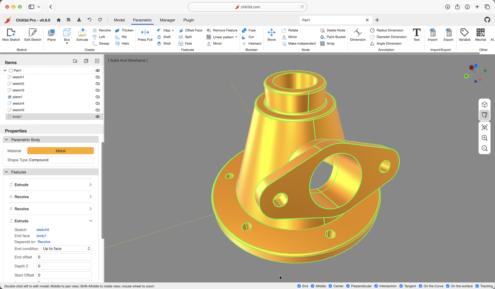

# Chili3D / Chili3D Pro 操作手册

适用于 **Chili3D v0.8.0**（文档格式版本 **0.7.1**），并包含 **Chili3D Pro v0.8** 的直接编辑说明。操作说明以简体中文界面为主，部分功能示例保留英文界面。

Chili3D 是一款运行在浏览器里的 3D CAD：建模内核 OpenCascade（OCCT）编译为 WebAssembly，视口由 Three.js 渲染。它把**直接建模**、**参数化建模**和 **AI 建模**放在同一个文档、同一个视口和同一个撤销栈里，因此三种方式可以随时切换。

Chili3D Pro 在此基础上增加**直接编辑**：双击模型进入编辑模式，直接修改可编辑节点的边、面和局部几何。入口、转换影响和完整命令流程见 [第 13 章](13-pro-direct-editing.md)。

*参数化机械零件：几何、项目树与特征列表位于同一文档（英文界面）。*

## 怎么读这本手册

- **第一次使用**：从 [第 1 章 快速开始](01-getting-started.md) 开始，跟着做一个零件。
- **想完成一个完整任务**：直接看 [第 12 章 典型工作流程](12-workflows.md)，包括参数化安装板、导入模型修补、AI 协作和交付检查。
- **想用 Pro 直接编辑**：读 [第 13 章 Pro 直接编辑](13-pro-direct-editing.md)，先确认可编辑节点转换和实例源修改的影响。
- **想用参数化/草图**：读 [第 6 章 参数化建模](06-parametric-modeling.md) 与 [第 7 章 草图](07-sketch.md)。
- **想处理导入模型**：读 [第 4 章](04-direct-modeling.md)、[第 5 章](05-modify-convert-measure.md) 和 [第 12.2 节](12-workflows.md#122-导入模型检查修补与重新导出)；Pro 用户还可参考 [第 13.9 节](13-pro-direct-editing.md#139-一个完整的-pro-修形流程)。
- **想用 AI 助手**：读 [第 9 章 AI 助手](09-ai-assistant.md)，特别注意对话与参考图片的保存和分享规则。
- **需要查命令或名词**：使用 [附录 A 命令速查表](appendix-commands.md)、[附录 B 快捷键](appendix-shortcuts.md) 和 [附录 C 术语表](appendix-glossary.md)。
- **遇到问题**：先在 [第 11 章 常见问题](11-faq.md) 按类别排查。

插图均为真实应用的静态画面；快速上手示例文档名为“法兰支架 / 法兰底板”。

## 使用前记住五件事

1. **单位固定**：长度为毫米，角度为度；表达式不要再写 `mm` 等单位后缀。
2. **没有自动保存**：日常用 `Ctrl+S`，重要节点再用 `保存到文件` 留下 `.cd` 备份。
3. **关闭文档前先保存**：关闭确认框的“取消”表示不保存并继续关闭，不是返回文档。
4. **参数化与直接建模不同**：前者可以编辑特征链，后者主要修改当前几何；选择方式见 [第 1.6 节](01-getting-started.md#16-三种建模方式怎么选)。
5. **Pro 转换和实例编辑要先确认影响**：参数化节点转为可编辑节点会丢失特征列表；双击实例会修改其源节点并影响共享实例。见 [第 13.2 节](13-pro-direct-editing.md#132-进入转换与退出)。

## 目录

1. [快速开始](01-getting-started.md) — 打开应用、新建文档、做出第一个零件、保存
2. [界面总览](02-interface.md) — 标题栏、功能区、视口、项目树、属性面板、状态栏、命令面板
3. [视图、选择与捕捉](03-view-navigation-selection.md) — 相机操作、显示模式、选择、捕捉、工作平面
4. [直接建模](04-direct-modeling.md) — 绘图、基本体、挤出/旋转/放样/扫掠、布尔、转换
5. [修改、测量与注释](05-modify-convert-measure.md) — 圆角倒角、移动阵列、修剪延伸、测量、尺寸标注、场景
6. [参数化建模](06-parametric-modeling.md) — 特征列表、拉伸与孔、重建恢复、变量表达式
7. [草图](07-sketch.md) — 草图会话、完全约束、尺寸、冲突恢复、构造线、外部参考
8. [文档、文件与撤销](08-document-files.md) — 保存与备份、导入导出、文档版本、撤销重做
9. [AI 助手](09-ai-assistant.md) — 配置模型、提示词、两种建模路径、上下文与隐私
10. [设置、插件与快捷键](10-settings-plugins.md) — 语言、主题、导航、插件安全、性能测试
11. [常见问题](11-faq.md) — 视图、草图、特征、文件、AI 与插件故障排查
12. [典型工作流程](12-workflows.md) — 参数化安装板、导入修补、AI 协作、交付清单
13. [Pro 直接编辑](13-pro-direct-editing.md) — 双击编辑、可编辑节点转换、拖拽、推拉/偏移、分割、辅助线、子形状修改与修复

附录：

- [附录 A 命令速查表](appendix-commands.md)
- [附录 B 快捷键与鼠标操作](appendix-shortcuts.md)
- [附录 C 术语表](appendix-glossary.md)

## 功能覆盖

| 功能域 | 覆盖章节 |
| --- | --- |
| 应用启动、首页、最近文档、语言/主题/导航设置 | 1、2、10 |
| 文档标签、项目树、属性面板、命令面板、状态栏、AI 面板 | 2 |
| 相机导航（5 套配置）、正交/透视、显示模式、视角书签 | 3 |
| 选择、框选、捕捉、追踪、动态工作平面 | 3 |
| 直接建模绘图与构造、布尔、转换、曲线投影、复制子形状 | 4 |
| 修改、阵列与实例、修剪、圆角/倒角、抽壳、修复、材质 | 5 |
| 测量、尺寸标注、文字注释、场景 | 5 |
| 参数化体、特征链、回滚条、抑制、重命名、重新选择、参数编辑 | 6 |
| 参数化特征（拉伸、旋转、放样、扫掠、螺旋、孔、筋、拔模、抽壳、加厚、圆角/倒角及修改、偏移面、分割、阵列、镜像、布尔、推拉） | 6 |
| 文档变量、量纲表达式、按变量抑制 | 6 |
| 草图绘图、13 种约束、7 种尺寸、驱动/从动、自由度与冲突恢复 | 7 |
| 草图修改、构造线、投影边、外部参考 | 7 |
| 文档保存、格式版本、导入导出、拖放、URL 参数、撤销/重做 | 8 |
| AI 配置、提示词、两种运行路径、图片参考、对话历史、隐私 | 9、12 |
| 插件加载与安全、宏管理器、可视化编程、性能测试 | 10 |
| 参数化安装板、导入修补、AI 协作、交付检查 | 12 |
| Pro 双击编辑、可编辑节点转换、实例源修改、编辑标签与隔离 | 2、13 |
| Pro 拖拽、推拉/偏移面、圆角/倒角、分割、辅助线、移动与修复 | 13 |
| 全部命令键、快捷键和常用术语 | 附录 A、B、C |

## 已知限制

- **应用不会自动保存**：不保存就关闭标签页，修改会丢失。见 [第 8 章](08-document-files.md)。
- 最近项目的删除会删除文档本体；不同浏览器源之间也不会自动同步文档。
- `.cd` 严格匹配独立的文档格式版本，不是应用版本号；跨版本交付优先另备 STEP/BREP。
- 新建文档的默认名称目前显示为 `undefined 1`、`undefined 2`……保存前建议选中项目树根节点，在属性面板里改为有意义的名字。
- 文档变量名必须是 ASCII 标识符（`[A-Za-z_][A-Za-z0-9_]*`），不能使用中文或空格。
- 视口里没有右键菜单（草图中右键可取消当前拾取）。模型树也没有右键菜单，重命名请在属性面板进行。
- 模型树的**可见性眼睛**、文件夹、拖放是树里仅有的直接操作；重命名、删除等走属性面板或功能区命令。
- **Pro 直接编辑不恢复参数化历史**：转换后的修改只改变当前几何；删除面可能留下开放壳，修复不能保证补回缺失面。见 [第 13 章](13-pro-direct-editing.md)。
